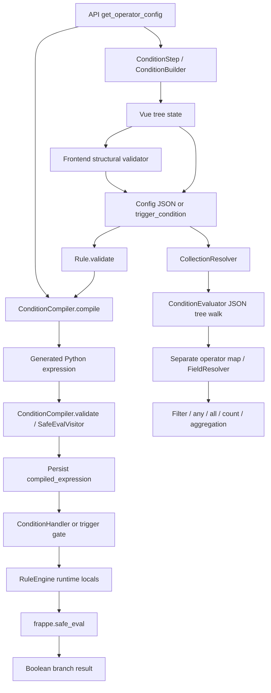

# FlexiRule Condition Comparison System — Canonical Architecture Audit

**Audit date:** 2026-10-17  
**Repository:** [Sendipad/flexirule](https://github.com/Sendipad/flexirule)  
**Authoritative baseline:** `develop` at `65c7372be0fe80261609fc122d153c3bb41d5199`  
**Framework source inspected:** Frappe `version-15` and `version-16` branches  
**Scope:** Read-only architecture analysis plus this report only. No application code, schema, tests, dependencies, workflows, or existing PRs were changed.  
**Canonical report location:** `reports/condition-comparison-architectural-audit.md` in PR #412. This is the sole maintained report for this audit.

## 1. Executive summary and canonical PR selection

### Decision: select PR #412 as the canonical path forward

**Select [PR #412 — condition comparison architectural audit](https://github.com/Sendipad/flexirule/pull/412) as the canonical architectural foundation.** Retain its core direction: build a strict, FlexiRule-owned condition contract and a structured, validated condition plan; unify comparison semantics across ordinary rule conditions and collection/value-resolver predicates; and retain Frappe's `frappe.safe_eval` only where a separate expression/formula feature genuinely requires restricted Python evaluation. Do not retain untrusted field-reference interpolation into generated Python as the condition language itself.

PR #412 is not perfect and is itself an analysis-only report, not an implementation PR. Its strongest recommendations must still be corrected and validated as listed below. Nevertheless, its architectural direction addresses the root problem: the same saved condition must have one defined meaning, and invalid input must never become an unconditional pass. PR #413 correctly identifies important drift but recommends keeping the current generated-Python compiler as the single transformation engine. That would centralize the current implementation without removing its unsafe permissive defaults or resolving the mismatch between comparison semantics and runtime contexts.

### One recommended architecture

Use this pipeline:

`Saved JSON condition tree → strict schema and metadata validation → normalized typed condition plan → one pure comparator / group evaluator → explicit result or diagnostic`

- **Persisted contract:** the declarative condition tree remains the source of truth in `Rule.trigger_condition` or `Rule Action.config`. Compiled output is derived data only.
- **Validation:** validate node shape, operators, operand arity and types, allowed scopes, field paths, collection operations, aliases, and fieldtype applicability against server-side metadata. Reject invalid configuration during save/activation, with a tree path in the error.
- **Plan building:** normalize compatible legacy shapes and approved aliases, then construct a structured plan. Do not generate Python source for ordinary comparisons.
- **Runtime:** use one resolver and one comparison implementation for trigger gates, Condition actions, nested collection predicates, and CollectionResolver operations. Give row predicates explicit parent-document and row/alias context rather than adapting semantics by maintaining a second operator map.
- **Expression features:** keep formula/resolver/expression syntax behind a separate, narrowly validated and restricted-evaluation boundary. Do not allow that feature to expand the ordinary condition grammar by accident.
- **Compactor:** initially compact serialization and representation only. Algebraic rewrites must be opt-in, semantics-preserving transformations proved by differential tests, not string substitutions or aggressive simplification.

Compilation/plan building is useful for early validation and avoiding repeated recursive schema interpretation. **Generated Python source is not necessary to obtain those benefits.**

### Release posture

Do not treat the current implementation as a stable semantic contract. The source confirms correctness defects: `like`/`not like` fall back to equality; unknown operators fall back to equality; malformed nodes and empty groups can disappear during compilation; `has_changed` compiles to `True`; null is rewritten to an empty string; mixed sibling logic differs between the two evaluators; and Link tuple comparison ignores the tuple's DocType. There are also contract and security-hardening risks involving unvalidated field paths and collection aliases. No exploit is claimed demonstrated.

These findings justify P0 hardening and semantic regression tests before business-critical use. A green broad test suite cannot establish semantic correctness for cases the suite does not cover.

## 2. Baseline, scope, provenance, and report review

### 2.1 Audited baseline

The current `develop` branch was fetched from GitHub and pinned to commit **`65c7372be0fe80261609fc122d153c3bb41d5199`** ([commit](https://github.com/Sendipad/flexirule/commit/65c7372be0fe80261609fc122d153c3bb41d5199)). The commit message is “Merge pull request #409 … Fix Query Records schema refresh on modal open”. The current README advertises Frappe v15+, and `pyproject.toml` declares Python `>=3.10`; Frappe is bench-managed rather than a pinned package dependency ([pyproject.toml](https://github.com/Sendipad/flexirule/blob/65c7372be0fe80261609fc122d153c3bb41d5199/pyproject.toml#L1-L14), [README](https://github.com/Sendipad/flexirule/blob/65c7372be0fe80261609fc122d153c3bb41d5199/README.md#L1-L18)).

### 2.2 PR #412 report and history

- [PR #412](https://github.com/Sendipad/flexirule/pull/412) is the primary PR and original review history. Its current report path is `reports/condition-comparison-architectural-audit.md`; this consolidated document replaces the original contents at that path.
- Original PR #412 audit commits included [`4c450476`](https://github.com/Sendipad/flexirule/commit/4c450476570eeabb2a85e9d77f28dd94772c740e) (“docs: add condition comparison architecture audit”) and [`44f42cad`](https://github.com/Sendipad/flexirule/commit/44f42cadf11ee525cfa1219a5701a463d4288e16) (report formatting).
- The new canonical-architecture analysis was reviewed and its source-verified conclusions are consolidated here rather than maintained as a second report file.
- Findings retained from both audits include incorrect `like` behavior; permissive unknown/malformed-condition handling; separate compiler/evaluator semantics; reference and alias construction risks; operand normalization and frontend contract drift; Frappe 16 verification gaps; and the corrected mixed-operator precedence finding.

### 2.3 PR #413 report and history

- [PR #413](https://github.com/Sendipad/flexirule/pull/413), head `be2c42b8a7e299dd8b5991216d52d9430400115c`, adds only `reports/condition_comparison_architectural_audit.md` (286 lines).
- Commit: [`be2c42b8`](https://github.com/Sendipad/flexirule/commit/be2c42b8a7e299dd8b5991216d52d9430400115c) (“docs: add architectural audit report for condition comparison system”).
- Valid findings include duplicate condition semantics, null/boolean normalization issues, and UI fallback operator duplication. Its proposed direction is to make `ConditionCompiler` the sole transformation engine and route CollectionResolver evaluation through it.
- Its report header says “February 2025”, although the report commit and PR were created on 2026-10-17. Treat that report date and any claimed execution environment as unverified provenance.
- It claims that `test_compiler`, `test_evaluator`, `test_engine`, and `bench build` passed in `/home/jules/frappe-bench`. Those local results were not reproduced by this audit, and no associated console transcript or artifact was attached in the report.

Both PRs target `develop` at the same audited base SHA and remain open/unmerged. Neither has submitted reviews or inline review threads. PR #412 has no issue comments; PR #413 has one unrelated automated Jules greeting, not a substantive architecture discussion. The GitHub Actions runs for both report-only heads show CI and linter workflows succeeded; that validates the report-only branches against their workflows, not the proposed architecture.

### 2.4 Section-numbering clarification

The two reports do **not** have equivalent Section 4 content. PR #412 Section 4 is an operator inventory/semantic matrix. PR #413 Section 4 is an end-to-end lifecycle stage map; its operator inventory is Section 5. The matrix below therefore compares the substantive claims from those sections and their linked recommendations, rather than treating the section numbers as equivalent.

## 3. Disagreement matrix: source-verified resolutions

“Verified” means the behavior is supported by the pinned source. “Partially correct” means a report identified a real concern but overstated or misdiagnosed it. Security-hardening concerns are distinguished from a proven exploit.

| Topic                                             | Competing claims / recommendations                                                                                                                                 | Source evidence and actual behavior                                                                                                                                                                                                                                                                                                                                                                                                                                                                                                                                                                                                                                                                                                                                                                                                                                                                                                                                                                                                                                                                                                                                                                                                                                                                                                                                        | Verdict and decision                                                                                                                                                                                                                                                                                                                                                                                                                                                                        |
| ------------------------------------------------- | ------------------------------------------------------------------------------------------------------------------------------------------------------------------ | -------------------------------------------------------------------------------------------------------------------------------------------------------------------------------------------------------------------------------------------------------------------------------------------------------------------------------------------------------------------------------------------------------------------------------------------------------------------------------------------------------------------------------------------------------------------------------------------------------------------------------------------------------------------------------------------------------------------------------------------------------------------------------------------------------------------------------------------------------------------------------------------------------------------------------------------------------------------------------------------------------------------------------------------------------------------------------------------------------------------------------------------------------------------------------------------------------------------------------------------------------------------------------------------------------------------------------------------------------------------------- | ------------------------------------------------------------------------------------------------------------------------------------------------------------------------------------------------------------------------------------------------------------------------------------------------------------------------------------------------------------------------------------------------------------------------------------------------------------------------------------------- |
| **Canonical architecture**                        | PR #412 favors a strict condition domain model / structured plan; PR #413 favors the current `ConditionCompiler` as the one compiler, then shares its output.      | `ConditionCompiler` builds Python strings from a declarative tree and relies on `validate()` plus runtime `frappe.safe_eval`; `ConditionEvaluator` separately dispatches operators. See [compiler.py](https://github.com/Sendipad/flexirule/blob/65c7372be0fe80261609fc122d153c3bb41d5199/flexirule/ruleflow/core/compiler.py#L131-L180), [evaluator.py](https://github.com/Sendipad/flexirule/blob/65c7372be0fe80261609fc122d153c3bb41d5199/flexirule/ruleflow/core/evaluator.py#L18-L36).                                                                                                                                                                                                                                                                                                                                                                                                                                                                                                                                                                                                                                                                                                                                                                                                                                                                                | **Select PR #412’s architectural direction.** Unifying through the present source-string compiler would centralize but preserve fallback-to-equality, raw string generation and Python-precedence behavior. Build a structured plan and one semantic engine instead.                                                                                                                                                                                                                        |
| **“Previous node” logical-operator bug**          | PR #413 says reading `prev_node.get("logical_operator")` is a bug and recommends the current node or the group default.                                            | `compiler.py` explicitly documents that in FlexiRule each condition’s `logical_operator` joins that condition to the **next** condition. `ConditionEvaluator._evaluate_group` also sets `current_operator` from the just-evaluated condition for the next iteration. See [compiler.py](https://github.com/Sendipad/flexirule/blob/65c7372be0fe80261609fc122d153c3bb41d5199/flexirule/ruleflow/core/compiler.py#L182-L216), [evaluator.py](https://github.com/Sendipad/flexirule/blob/65c7372be0fe80261609fc122d153c3bb41d5199/flexirule/ruleflow/core/evaluator.py#L64-L104).                                                                                                                                                                                                                                                                                                                                                                                                                                                                                                                                                                                                                                                                                                                                                                                              | **The specific bug claim is incorrect.** Keep the “operator on this item joins to the next item” contract unless product/UI evidence changes it. However, a real mismatch exists: the compiler emits e.g. `A or B and C`, whose Python precedence is `A or (B and C)`; the JSON evaluator folds left-to-right as `(A or B) and C`. For A=True, B=False, C=False these can differ. Fix by encoding the agreed semantics explicitly in the plan and tests, not by blindly switching to `sub`. |
| **`like` and `not like`**                         | PR #412 flags both as visible “contains” operators that compile to equality; PR #413 concentrates on evaluator unification and does not elevate this to a finding. | `FIELDTYPE_OPERATORS` exposes `like`/`not like`, and labels map them to “contains”; `OPERATOR_MAP` lacks both tokens, while `_compile_condition` uses `self.OPERATOR_MAP.get(op, "==")`. Explicit substring branches are for `contains`/`not_contains`. See [compiler.py](https://github.com/Sendipad/flexirule/blob/65c7372be0fe80261609fc122d153c3bb41d5199/flexirule/ruleflow/core/compiler.py#L18-L80) and [compiler.py](https://github.com/Sendipad/flexirule/blob/65c7372be0fe80261609fc122d153c3bb41d5199/flexirule/ruleflow/core/compiler.py#L218-L290).                                                                                                                                                                                                                                                                                                                                                                                                                                                                                                                                                                                                                                                                                                                                                                                                           | **PR #412 is correct.** This is a user-visible correctness bug. Decide whether these are literal substring aliases or a distinct SQL-like pattern operator. Do not silently change existing saved rules: inventory them and apply an explicit compatibility/migration policy.                                                                                                                                                                                                               |
| **Unknown operators and aliases**                 | PR #412 recommends rejecting unsupported tokens; PR #413 recommends synchronizing compiler and evaluator capabilities.                                             | Compiler’s unknown-token default is equality. The evaluator recognizes `not_in`, while compiler `OPERATOR_MAP` contains `not in` but not `not_in`; `not_in` therefore normally compiles as equality except the Link-tuple special case. The evaluator also has `regex`, which the compiler does not implement as a normal comparison. See [compiler.py](https://github.com/Sendipad/flexirule/blob/65c7372be0fe80261609fc122d153c3bb41d5199/flexirule/ruleflow/core/compiler.py#L218-L290), [evaluator.py](https://github.com/Sendipad/flexirule/blob/65c7372be0fe80261609fc122d153c3bb41d5199/flexirule/ruleflow/core/evaluator.py#L18-L36).                                                                                                                                                                                                                                                                                                                                                                                                                                                                                                                                                                                                                                                                                                                              | **Both identify drift; PR #412’s strict rejection is the safer rule.** Normalize only an explicit, versioned alias set. All other tokens must produce validation errors, never equality.                                                                                                                                                                                                                                                                                                    |
| **Malformed node / empty condition pass-through** | PR #412 identifies permissive malformed conditions; PR #413 assumes compiler syntax validation is sufficient and recommends retaining that pipeline.               | `_compile_node` returns `""` for an unrecognized node; `_compile_group` skips empty compiled children; top-level `compile` returns `"True"` if the node compiles to an empty string. Empty inputs can also return `""`, and ConditionHandler treats a missing expression as a pass. Tree shape is not checked against a full condition schema. See [compiler.py](https://github.com/Sendipad/flexirule/blob/65c7372be0fe80261609fc122d153c3bb41d5199/flexirule/ruleflow/core/compiler.py#L131-L180), [condition.py](https://github.com/Sendipad/flexirule/blob/65c7372be0fe80261609fc122d153c3bb41d5199/flexirule/ruleflow/core/action_handlers/condition.py#L62-L97).                                                                                                                                                                                                                                                                                                                                                                                                                                                                                                                                                                                                                                                                                                     | **PR #412 is correct. P0.** Reject malformed tree nodes and invalid empty groups at server validation. Keep “no condition configured” as an explicit, contextual state; never obtain a passing condition through failed compilation.                                                                                                                                                                                                                                                        |
| **Null, empty-string, booleans, and types**       | Both reports identify `None → ''`; PR #413 further notes `True/False → 1/0`.                                                                                       | `_compile_operand_value` rewrites `None` to `''`, `True` to `1`, and `False` to `0`; the JSON evaluator retains values and uses Python operators. The compiler helper `is_empty_value` additionally treats whitespace-only strings and empty containers as empty, while `is_set` checks only `None` and `''`. See [compiler.py](https://github.com/Sendipad/flexirule/blob/65c7372be0fe80261609fc122d153c3bb41d5199/flexirule/ruleflow/core/compiler.py#L380-L430) and [engine.py](https://github.com/Sendipad/flexirule/blob/65c7372be0fe80261609fc122d153c3bb41d5199/flexirule/ruleflow/core/engine.py#L755-L868).                                                                                                                                                                                                                                                                                                                                                                                                                                                                                                                                                                                                                                                                                                                                                       | **Both are correct.** Keep literal null distinct from empty string and boolean distinct from integer in the condition plan. Define a deliberate Fieldtype normalization policy and separate semantics for `is_set` and `is_empty`. Do not rely on incidental Python coercion.                                                                                                                                                                                                               |
| **Generated reference strings / AST “safety”**    | PR #412 calls for hardening raw field-reference interpolation; PR #413 characterizes the AST + `safe_eval` boundary as robust.                                     | `_resolve_ref` interpolates path segments into single-quoted Python source; collection `alias` is placed directly into a generated comprehension. FlexiRule’s `SafeEvalVisitor` blocks dunder names/attributes and import nodes, but is not a condition-tree schema validator or a complete allowlist of generated syntax. Frappe `safe_eval` adds RestrictedPython compilation, empty builtins, and whitelisted globals; that is valuable, but does not validate business meaning or make raw reference interpolation a sound design. See [compiler.py](https://github.com/Sendipad/flexirule/blob/65c7372be0fe80261609fc122d153c3bb41d5199/flexirule/ruleflow/core/compiler.py#L328-L509), [permissions.py](https://github.com/Sendipad/flexirule/blob/65c7372be0fe80261609fc122d153c3bb41d5199/flexirule/ruleflow/core/permissions.py#L245-L291), and Frappe v15/v16 [safe_exec.py](https://github.com/frappe/frappe/blob/version-15/frappe/utils/safe_exec.py#L132-L149) / [safe_exec.py](https://github.com/frappe/frappe/blob/version-16/frappe/utils/safe_exec.py#L136-L149).                                                                                                                                                                                                                                                                                       | **PR #412 is directionally correct; PR #413 overstates what its validation proves.** No arbitrary-code exploit was demonstrated here. Remove field-path and alias source generation for normal conditions. Validate path tokens, scope, field metadata and aliases before runtime; retain Frappe restricted evaluation only for explicitly designed expression features.                                                                                                                    |
| **Collection predicates and operator context**    | PR #412 recommends one shared comparator; PR #413 recommends making CollectionResolver use compiler output and supplying common helpers.                           | Rule actions execute compiled expressions via `RuleEngine._evaluate_python_condition`; `CollectionResolver` creates a `ConditionEvaluator` and passes each row via `evaluate(doc, row=r)`. A simple compiler substitution does not automatically preserve the parent document + row alias model. Compiler collection logic defaults unknown collection `op` to `any`, and a missing/invalid `where` can compile to `True`; evaluator returns False for invalid non-list collection values and True for a missing `where`. See [value_resolver.py](https://github.com/Sendipad/flexirule/blob/65c7372be0fe80261609fc122d153c3bb41d5199/flexirule/ruleflow/core/value_resolver.py#L475-L590), [compiler.py](https://github.com/Sendipad/flexirule/blob/65c7372be0fe80261609fc122d153c3bb41d5199/flexirule/ruleflow/core/compiler.py#L292-L326), and [evaluator.py](https://github.com/Sendipad/flexirule/blob/65c7372be0fe80261609fc122d153c3bb41d5199/flexirule/ruleflow/core/evaluator.py#L64-L180).                                                                                                                                                                                                                                                                                                                                                                       | **Keep the unification goal; reject a mechanical “compile instead” migration.** A single plan evaluator must explicitly model parent, row, aliases, empty sets, and error semantics. Unknown collection operations and malformed `where` trees must fail validation.                                                                                                                                                                                                                        |
| **Link / Dynamic Link semantics**                 | PR #412 notes the DocType in Link tuples is not validated; PR #413 treats Link tuple helpers as reusable semantics.                                                | `check_link_match` documents that `rhs[0]` is included but not validated; it compares only `rhs[1]`. Thus two records with the same key but different DocTypes may compare equal if the same helper is used. See [evaluator.py](https://github.com/Sendipad/flexirule/blob/65c7372be0fe80261609fc122d153c3bb41d5199/flexirule/ruleflow/core/evaluator.py#L280-L315).                                                                                                                                                                                                                                                                                                                                                                                                                                                                                                                                                                                                                                                                                                                                                                                                                                                                                                                                                                                                       | **PR #412 is correct.** Validate the tuple’s DocType against the Link/Dynamic Link field metadata and make key normalization explicit. Do not collapse Link identity to a value string without a documented contract.                                                                                                                                                                                                                                                                       |
| **Regex support / cost**                          | PR #412 identifies `regex` as evaluator-only with no resource policy; PR #413 does not list it as a primary finding.                                               | The tree evaluator calls Python `re.search`; normal compiler operator handling does not expose matching semantics for `regex`. Python’s standard `re` API here has no per-match timeout. See [evaluator.py](https://github.com/Sendipad/flexirule/blob/65c7372be0fe80261609fc122d153c3bb41d5199/flexirule/ruleflow/core/evaluator.py#L18-L36).                                                                                                                                                                                                                                                                                                                                                                                                                                                                                                                                                                                                                                                                                                                                                                                                                                                                                                                                                                                                                             | **PR #412 is correct.** Do not advertise `regex` as generally supported until a resource-safety and pattern-policy decision is implemented. Otherwise reject/deprecate it consistently.                                                                                                                                                                                                                                                                                                     |
| **Frontend and payload contract**                 | Both reports flag operator arrays and UI/backend drift; PR #413 recommends removing frontend fallbacks because the API is the single source.                       | `get_operator_config` returns compiler metadata; `SimpleCondition.vue` nevertheless retains `DEFAULT_OPERATORS` and `DEFAULT_LABELS` fallback lists. The frontend validator primarily checks tree shape and required values; backend Condition validation primarily checks payload/compiled-expression presence, not complete operator/fieldtype validity. JS recognizes an array as a condition payload, while `ConditionBuilder.normalizeModel` expects an object with `op` and `conditions`; hydrating a legacy root array can therefore render as an empty group. See [api.py](https://github.com/Sendipad/flexirule/blob/65c7372be0fe80261609fc122d153c3bb41d5199/flexirule/ruleflow/api.py#L619-L629), [SimpleCondition.vue](https://github.com/Sendipad/flexirule/blob/65c7372be0fe80261609fc122d153c3bb41d5199/flexirule/public/js/flexirule/rule_builder/components/condition_builder/SimpleCondition.vue#L68-L119), [condition_validator.js](https://github.com/Sendipad/flexirule/blob/65c7372be0fe80261609fc122d153c3bb41d5199/flexirule/public/js/flexirule/rule_builder/components/condition_builder/condition_validator.js#L5-L104), and [ConditionBuilder.vue](https://github.com/Sendipad/flexirule/blob/65c7372be0fe80261609fc122d153c3bb41d5199/flexirule/public/js/flexirule/rule_builder/components/condition_builder/ConditionBuilder.vue#L24-L120). | **Both identify real drift.** Publish operator metadata from the canonical backend definition and use frontend validation for UX only. Normalize legacy list payloads into the canonical group before the UI receives them; add load-edit-save round-trip tests.                                                                                                                                                                                                                            |
| **Frappe v15/v16 claim**                          | PR #412 says full v16 condition compatibility is unestablished; PR #413 labels the code forward-compatible with v16.                                               | Both version branches expose `frappe.safe_eval` and use RestrictedPython, but internal compilation paths differ slightly (`compile_restricted` directly in v15 versus `_compile_code` helper in v16). The repository workflow has a Frappe 15 server job; its separate Frappe 16 job is a nested-set integration job and was skipped in the baseline run. See [CI workflow](https://github.com/Sendipad/flexirule/blob/65c7372be0fe80261609fc122d153c3bb41d5199/.github/workflows/ci.yml#L82-L105) and [Frappe 16 workflow setup](https://github.com/Sendipad/flexirule/blob/65c7372be0fe80261609fc122d153c3bb41d5199/.github/workflows/ci.yml#L281-L310).                                                                                                                                                                                                                                                                                                                                                                                                                                                                                                                                                                                                                                                                                                                 | **PR #412 is correct.** The presence of `safe_eval` in both branches is not proof of condition-engine compatibility. Add the same semantic tests on every officially supported Frappe branch.                                                                                                                                                                                                                                                                                               |
| **Tests cited by PR #413**                        | PR #413 reports 27 compiler, 22 evaluator, 5 engine tests plus frontend build as passed; PR #412 says it did not run direct tests.                                 | This audit did not independently execute a Frappe/bench test command. GitHub Actions for the baseline `develop` SHA shows a successful CI run with Frontend and Server (Frappe 15) jobs succeeded; server log says `Ran 581 tests in 19.063s`. The “Nested-set integration (Frappe 16)” job was skipped.                                                                                                                                                                                                                                                                                                                                                                                                                                                                                                                                                                                                                                                                                                                                                                                                                                                                                                                                                                                                                                                                   | **Baseline CI pass is verified; PR #413’s local test transcript is unverified here.** Report the known CI result accurately and do not imply that these architecture edge cases are covered by the 581 tests.                                                                                                                                                                                                                                                                               |

## 4. Current architecture and end-to-end lifecycle

### 4.1 Architecture map

### 4.2 Lifecycle by source

1. **Configure and hydrate.** `ConditionStep.vue` hydrates condition payload into a Vue model and adds temporary IDs for reactivity. The same component strips IDs before saving; entry conditions go to `trigger_condition`, while a Condition action stores configuration in `config` and clears the legacy `condition_json` field. ([ConditionStep.vue](https://github.com/Sendipad/flexirule/blob/65c7372be0fe80261609fc122d153c3bb41d5199/flexirule/public/js/flexirule/rule_builder/components/rule_config/types/ConditionStep.vue#L60-L170))
2. **Metadata and operator controls.** The API returns `ConditionCompiler.FIELDTYPE_OPERATORS` and `OPERATOR_LABELS`. The UI uses Frappe field metadata but also has local operator fallbacks. ([api.py](https://github.com/Sendipad/flexirule/blob/65c7372be0fe80261609fc122d153c3bb41d5199/flexirule/ruleflow/api.py#L619-L629), [SimpleCondition.vue](https://github.com/Sendipad/flexirule/blob/65c7372be0fe80261609fc122d153c3bb41d5199/flexirule/public/js/flexirule/rule_builder/components/condition_builder/SimpleCondition.vue#L68-L119))
3. **Frontend validation.** `validateConditions` checks groups, collections, field reference presence, operators and required values. It is useful for UX but cannot be trusted as server validation because rules can be submitted outside the UI. ([condition_validator.js](https://github.com/Sendipad/flexirule/blob/65c7372be0fe80261609fc122d153c3bb41d5199/flexirule/public/js/flexirule/rule_builder/components/condition_builder/condition_validator.js#L5-L104))
4. **Server save lifecycle.** `Rule.validate()` calls `compile_conditions()` before `validate_with_service()`. Compilation runs for the trigger condition and each Condition action; payloads are normalized back into `config` for legacy-field migration. ([rule.py](https://github.com/Sendipad/flexirule/blob/65c7372be0fe80261609fc122d153c3bb41d5199/flexirule/ruleflow/doctype/rule/rule.py#L117-L170), [rule.py](https://github.com/Sendipad/flexirule/blob/65c7372be0fe80261609fc122d153c3bb41d5199/flexirule/ruleflow/doctype/rule/rule.py#L1283-L1346))
5. **Compile and validate.** `ConditionCompiler.compile` converts the tree into source code. `validate` checks syntax and calls `validate_safe_eval`, but does not verify the full tree schema, operator allowlist, operand arity, or fieldtype applicability. The result can still be semantically wrong while syntactically valid. ([compiler.py](https://github.com/Sendipad/flexirule/blob/65c7372be0fe80261609fc122d153c3bb41d5199/flexirule/ruleflow/core/compiler.py#L131-L180), [compiler.py](https://github.com/Sendipad/flexirule/blob/65c7372be0fe80261609fc122d153c3bb41d5199/flexirule/ruleflow/core/compiler.py#L328-L378))
6. **Normal runtime path.** ConditionHandler reads the persisted `compiled_expression`; RuleEngine supplies `doc`, `old_doc`, `vars`, row-related helpers and Frappe metadata helpers; `eval_condition_bool` evaluates through `frappe.safe_eval`. Most runtime exceptions become the default false result, but `NameError` is re-raised. ([condition.py](https://github.com/Sendipad/flexirule/blob/65c7372be0fe80261609fc122d153c3bb41d5199/flexirule/ruleflow/core/action_handlers/condition.py#L62-L97), [engine.py](https://github.com/Sendipad/flexirule/blob/65c7372be0fe80261609fc122d153c3bb41d5199/flexirule/ruleflow/core/engine.py#L755-L868), [runtime_eval.py](https://github.com/Sendipad/flexirule/blob/65c7372be0fe80261609fc122d153c3bb41d5199/flexirule/ruleflow/core/runtime_eval.py#L48-L74))
7. **Alternate resolver path.** CollectionResolver uses the JSON `ConditionEvaluator` with an explicit row. It has a separate operator map, value resolution and error handling. Unifying this path requires the canonical runtime plan to model row aliases and the parent document; simply calling the existing compiler string is not semantically equivalent. ([value_resolver.py](https://github.com/Sendipad/flexirule/blob/65c7372be0fe80261609fc122d153c3bb41d5199/flexirule/ruleflow/core/value_resolver.py#L475-L590), [evaluator.py](https://github.com/Sendipad/flexirule/blob/65c7372be0fe80261609fc122d153c3bb41d5199/flexirule/ruleflow/core/evaluator.py#L64-L180))

## 5. Frappe and Python API findings

### 5.1 `frappe.safe_eval`

The inspected Frappe v15 implementation normalizes source, validates syntax, empties `__builtins__`, adds a whitelist of safe-eval globals, compiles with RestrictedPython, and evaluates against explicit globals/locals ([Frappe v15 source](https://github.com/frappe/frappe/blob/version-15/frappe/utils/safe_exec.py#L132-L149)). Frappe v16 retains the public `safe_eval(code, eval_globals, eval_locals)` entry point with a helper for restricted compilation ([Frappe v16 source](https://github.com/frappe/frappe/blob/version-16/frappe/utils/safe_exec.py#L132-L159)).

**Architecture implication:** retain this boundary for a separate formula/resolver expression feature where required. It is not a condition schema, operator registry, type system, or guarantee that an arbitrary generated expression has the intended business meaning. FlexiRule’s AST visitor specifically blocks dunder access and import nodes; it does not substitute for strict condition validation. The concern in this audit is unsound source generation and inconsistent semantics, not a claim of demonstrated arbitrary OS-level execution.

### 5.2 Metadata and field handling

The current engine already uses public Frappe metadata APIs: `frappe.get_meta(doctype)`, `meta.is_submittable`, and `meta.has_field(fieldname)`. Reuse these for the server validator’s fieldtype/options/context checks. Resolve runtime values from the actual evaluation context; do not replace in-memory comparison with SQL filters because conditions may observe unsaved `doc` state, `old_doc`, `vars`, and child rows. The query/filter engine is not a drop-in evaluator for these objects.

### 5.3 Frappe compatibility evidence

Repository `pyproject.toml` sets Python `>=3.10`. The baseline workflow’s server job checks out Frappe `version-15` on Python 3.10; a distinct Frappe 16 workflow job is limited to nested-set integration and was skipped in the baseline run. This is **not** a Frappe 15/16 condition-engine matrix. If v16 remains a supported target, execute semantic tests for the condition engine against both versions before claiming compatibility.

### 5.4 Transactions, permissions, and failure handling

The comparator should be pure: no writes, commits, or hidden mutations while testing a predicate. Any external read/metadata access belongs behind explicit, permission-reviewed adapters rather than implicit generated source. Save-time configuration errors should raise actionable validation errors. Runtime evaluation errors must be logged and surfaced distinctly from a legitimate `False` result; silently selecting the false branch and continuing can disguise a bad rule as a business decision. The product must choose a consistent rule-execution policy for runtime errors (fail the current rule/run or apply an explicit fail-closed policy), rather than relying on broad exception handlers in two engines.

## 6. Supported semantics: current behavior versus target contract

This table deliberately separates what the code **currently does** from the behavior recommended for the canonical design.

| Feature                        | Current source behavior / discrepancy                                                                                                                                                                   | Canonical contract decision                                                                                                                                                                                   |
| ------------------------------ | ------------------------------------------------------------------------------------------------------------------------------------------------------------------------------------------------------- | ------------------------------------------------------------------------------------------------------------------------------------------------------------------------------------------------------------- |
| Equality / inequality          | Python equality in compiled source; `operator.eq/ne` in JSON evaluator. Values are not normalized consistently.                                                                                         | One comparator. Validate/normalize operands by field metadata before comparison.                                                                                                                              |
| Numeric and temporal ordering  | Native Python `>`, `<`, `>=`, `<=`; incompatible values can throw and then be converted to False in some paths.                                                                                         | Define number precision, `Decimal`/float conversion, date/time parsing, timezone rules, and invalid-input behavior; reject incompatible constants at save time where possible.                                |
| `in` / `not in`                | Compiler understands `not in`; evaluator also normalizes `not_in`. Evaluator forces false/true for falsy RHS values, while normal Python operations can error for a null or wrong-type RHS.             | Canonical `in` and `not_in` aliases; enforce RHS collection/type contract. Preserve empty-list math (`x in []` false, `x not in []` true) but reject null/wrong-shape RHS instead of silently substituting.   |
| `like` / `not like`            | Displayed as contains, but compiled to equality.                                                                                                                                                        | Make approved aliases to one explicit operator only after inventory and migration policy. Decide literal substring versus wildcard-pattern meaning; never silently reinterpret old conditions.                |
| `contains` / `not_contains`    | Compiled with string coercion of LHS if truthy; separate lambdas in the evaluator. RHS isn't normalized centrally.                                                                                      | Explicit case-sensitivity and conversion rules; share one implementation. Decide whether falsy LHS means false/true or whether it is handled through null policy.                                             |
| `is_set` / `is_not_set`        | `None` and `''` count as unset; whitespace-only string counts as set.                                                                                                                                   | Preserve this as a distinct, documented predicate unless the product contract deliberately changes it; test whitespace explicitly.                                                                            |
| `is_empty` / `is_not_empty`    | Compiled helpers consider `None`, whitespace-only strings, and empty list/tuple/dict/set empty. JSON evaluator lacks these operations.                                                                  | Define container and whitespace semantics once and use the same comparator in all contexts.                                                                                                                   |
| `length_*`                     | Compiler-only length helper; strips string whitespace before counting and counts containers by `len`.                                                                                                   | Decide whether string length trims whitespace. Implement the same helper everywhere and validate RHS as integer.                                                                                              |
| `is_submittable` / `has_field` | Special compiler helpers; not in the normal fieldtype operator arrays for general fields.                                                                                                               | Treat as metadata/context predicates with dedicated schemas, not as general field comparisons. Validate argument types and context.                                                                           |
| `regex`                        | JSON evaluator only, using `re.search`; lacks a cost policy and is not a normal compiler operator.                                                                                                      | Disable/reject until a safe pattern/resource policy is chosen; never leave it available in only one execution context.                                                                                        |
| `is` / `is not`                | Present in compiler map but not normal fieldtype UI lists. Identity semantics on serialized business values are unclear.                                                                                | Do not expose generically. Use equality or explicit null/set predicates unless a narrow identity use case is specified.                                                                                       |
| `has_changed`                  | Compiler warns and returns literal `True`; any surviving condition using it passes regardless of field state.                                                                                           | P0: reject on save/activation and provide a migration diagnostic. Do not preserve an unconditional pass as “backward compatibility”.                                                                          |
| Link / Dynamic Link            | Tuple helper ignores tuple DocType and compares only the target value; identical keys can collide across DocTypes.                                                                                      | Verify Link field options and Dynamic Link target type before comparison; compare canonical identity including the valid target DocType.                                                                      |
| Nested groups                  | Nested group expressions are parenthesized, but mixed logical operators among siblings are emitted as raw `and`/`or` source and inherit Python precedence. JSON evaluator left-folds sibling operators. | Define group operator and sibling-join semantics explicitly, store/construct a plan preserving grouping, and test truth tables. Never depend on host-language precedence accidentally.                        |
| `any` / `all` / `none`         | Compiled collection conditions use Python `any/all/not any`, default unknown operation to `any`, and replace missing `where` with `True`; evaluator has different invalid collection/error results.     | Strictly allow only these tokens, require a valid `where` tree, define empty-list truth values (including vacuous `all([]) = true` if accepted), and distinguish invalid collection from an empty collection. |
| Unknown/malformed input        | Unknown operation becomes equality; bad leaf may compile to no expression; invalid references can resolve to `''`.                                                                                      | Reject with a node-path diagnostic before plan execution. Never map malformed input to a passing Boolean.                                                                                                     |

### 6.1 Null, missing, and falsy values

Current `_compile_operand_value` conflates explicit `None` with `''` and maps booleans to integers. This changes comparisons independently of whether a given Frappe field happens to store empty text. The canonical plan should preserve literal type and, where meaningful, distinguish a missing path from an explicit null value. If the product intentionally treats absent fields as null, encode that as an explicit resolution rule—not a side effect of Python string generation.

Falsy values are not all empty: `0` and `False` must not be treated like `None`, `''`, empty list, or empty mapping by a generic truthiness check. The distinction between `is_set` and `is_empty` must remain explicit unless a versioned business-contract change says otherwise.

### 6.2 Operator registry responsibility

The registry should be a small immutable definition table, not a plugin framework. Each definition should specify:

- canonical token, label key and approved legacy aliases;
- unary/binary arity and permitted operand shape;
- valid fieldtype families and any DocType metadata preconditions;
- the comparison/metadata predicate implementation;
- type-normalization, null/empty and error policy;
- support status and deprecation/migration message.

The API should expose a UI-safe DTO derived from that definition. Frontend display grouping and order may remain presentation concerns; operator meaning and server enforcement must not be duplicated in Vue fallback arrays.

## 7. Condition Compactor design and semantic-equivalence rules

The safest first compactor is a **canonical serializer and validated plan normalizer**, not a Boolean algebra optimizer. The current payload is declarative JSON and the compiler’s output is derived. Compaction should not alter business decisions or error visibility.

### 7.1 Safe first-stage compaction

1. Normalize only schema-approved legacy payload shapes into one canonical root group.
2. Normalize known operator aliases only through an explicit, versioned alias table after impact analysis. Do not reinterpret `like` as substring silently because current runtime has equality behavior and users may have compensated for it.
3. Strip UI-only IDs; canonicalize only JSON structure/order where ordering is non-semantic by contract.
4. Normalize simple wrapper nodes only when equivalent behavior is proven: no per-sibling logical operator, error boundary, row-scope, or empty-group behavior may be lost.
5. Build and cache a derived plan keyed by normalized configuration and semantic version, but invalidate/rebuild it when configuration or operator semantics change. Keep cache work behind evidence that it has real consumers and a measured benefit.

### 7.2 Rewrites that must not be applied casually

- **Do not reorder predicates.** Short-circuit ordering changes which resolution errors or diagnostics surface; order can matter even for a Boolean result that otherwise appears commutative.
- **Do not merge `A or B and C` into another grouping by assumption.** First define the exact current/UI contract and encode it structurally.
- **Do not collapse null into empty string**, or booleans into integers, to make string expressions shorter.
- **Do not remove duplicate predicates** until predicate evaluation is pure/total by contract and tests prove that duplicate evaluation has no visible effect on errors or diagnostics.
- **Do not flatten groups with different operators**, group-local behavior, or differing row aliases.
- **Do not simplify an empty group to True** merely because a compiler currently does so. Empty configuration and a valid logical identity (`AND` identity True, `OR` identity False) are different schema states; validate intent explicitly.
- **Do not turn a failed comparison or invalid path into False/True without a diagnostic.** A runtime error and a legitimate false predicate are distinct results.

Any later algebraic compaction should be implemented over typed condition-plan nodes with narrowly defined rewrite rules and property/differential tests against the canonical evaluator. Do not build source-to-source Python rewrites.

### 7.3 Error contract

- Invalid JSON/schema/operator/path/operand: reject save or activation with a precise path such as `conditions[2].right`.
- Valid predicate returning false: normal false branch.
- Runtime resolution or comparator failure: typed evaluation error and durable diagnostic; abort or follow an explicit configured failure policy. Never let a broad exception handler silently turn every error into an ordinary false branch.
- Missing/unconfigured condition: an explicit action/trigger contract state, not an accidental consequence of an empty compiled expression.

## 8. Additional source-verified defects and risks

1. **`has_changed` is hard-coded to pass.** `ConditionCompiler._compile_condition` warns that the operator is deprecated but returns `"True"`. A stale rule can therefore pass regardless of field changes. Reject and inventory these saved configurations before activation; do not silently preserve the behavior.
2. **Field references can alter generated grammar.** `_resolve_ref` interpolates a field name or nested subpath inside single quotes instead of validating tokens and binding data separately. Collection aliases are inserted as Python identifiers without an identifier/schema check. This creates malformed-source and semantic-manipulation risks. This audit did not demonstrate arbitrary code execution.
3. **Invalid scopes/operands degrade to `''`.** Unknown scopes and absent `ref`/`value` operands can compile to an empty-string literal. That is too permissive for a rule that controls business flow.
4. **Collection operation and `where` validation are incomplete.** Unknown collection op defaults to `any`; a malformed `where` can default to `True`. Valid empty-list behavior must not be confused with invalid condition shape.
5. **Link comparison discards target DocType.** Fixing only the compiler/evaluator parity will preserve this defect unless the canonical comparator checks field metadata and the Link target.
6. **Legacy root arrays can be lost in frontend editing.** The payload helper recognizes an array as a condition payload and `ConditionStep` can hydrate it as an array, but `ConditionBuilder.normalizeModel` only reads object properties `op` and `conditions`. The UI expects a root group object. Normalize root arrays before the component boundary and test load → edit → save.
7. **Frontend value state may outlive operator/field changes.** `SimpleCondition.vue` initializes a missing RHS on change but does not establish an authoritative server-enforced operand type policy. Changing field type/operator can leave a stale RHS shape. Server validation must be decisive.
8. **Failure handling is ambiguous.** The compiled path rethrows `NameError` but returns a default false for many other exceptions; the tree evaluator logs broad exceptions and returns false. Branches can mistake a broken condition for a legitimate no-match.
9. **Existing tests are not a semantic parity suite.** The test modules exercise both engines, but the architecture includes no demonstrated comprehensive differential suite that compares action/trigger and collection resolver semantics across all operators, null/missing values, mixed AND/OR, and failures.
10. **Assignment operations are a separate domain.** `core/operators.py` defines assignment transformations such as set/clear/increment/append/toggle. These are not comparison predicates. Do not merge assignment operations with the condition comparison registry; share only genuinely generic type/metadata helpers.

## 9. What to retain, reject, and correct from the reports

### Retain from PR #412

- Structured plan and one semantic layer as the architectural target.
- Reject-on-invalid behavior rather than unknown-to-equality or empty-to-pass behavior.
- Explicit semantics for values, Link types, collection edges, regex cost, and runtime diagnostics.
- Frappe metadata reuse without replacing in-memory evaluation with SQL.
- Migration inventory and differential test plan before changing existing saved-rule semantics.

### Retain from PR #413

- The end-to-end lifecycle summary: front-end JSON, save-time compilation, action runtime, and the separate CollectionResolver tree-evaluation path.
- The correct observations about `None`/boolean coercion and UI fallback duplication.
- The objective of one reusable operator definition and one evaluator path.
- The existing engine helpers and Frappe metadata should be reused when the desired business semantics match and context is explicit.

### Reject or correct

- Reject PR #413’s claim that reading `prev_node.logical_operator` is itself the logical-joining bug. The code explicitly defines it as the operator joining with the next sibling. Correct the real defect: the compiler’s Python precedence and evaluator’s left-fold precedence differ for mixed sibling operators.
- Reject PR #413’s proposal to make the present generated-Python compiler the canonical condition engine without first fixing its permissive fallbacks and generated-source design. Do not mechanically feed compiler strings into collection rows; that path needs explicit parent/row/alias semantics.
- Correct PR #412’s operator matrix wherever it implies all non-empty RHS values use a meaningful, stable native comparison: coercion and error behavior are not fully defined. For example, the difference for `in`/ `not in` is primarily invalid/falsy RHS handling; an empty list itself follows the expected false/true membership truth values in both paths.
- Reject any recommendation to treat a green test suite or presence of Frappe’s `safe_eval` as proof of semantic or complete sandbox correctness.
- Do not merge the assignment-operation system into comparison operators.
- Do not introduce a broad extension/plugin registry. A small explicit definition table is sufficient.

## 10. Prioritized implementation plan

### P0 — Validate before execution and close fail-open cases

1. Introduce a server-side condition schema validator that rejects unknown node shapes, invalid operators, missing required operands, invalid logical ops, malformed groups, bad collection ops/`where`, invalid scopes, and invalid aliases/field references.
2. Remove unknown-operator-to-equality, invalid-reference-to-empty-string, malformed-node-skipping, and compile-empty-to-True fallbacks. Return actionable validation errors.
3. Replace raw field-name and nested-path string interpolation with validated path tokens resolved at runtime. If generated Python remains for separate expression features, quote all data safely and keep the expression grammar distinct.
4. Reject `has_changed` during save/activation and report affected rules for migration.
5. Separate valid empty/missing configuration from compiled output; an empty source string must not be a condition result.

### P1 — Lock down canonical semantics and implement the single plan evaluator

6. Specify the condition-tree schema, including whether sibling `logical_operator` joins the next item and how it associates; retain nested groups for explicit precedence.
7. Add a versioned operator definition table with arity, operand types, fieldtype applicability, aliases, null/empty semantics, and failure policy.
8. Implement a normalized plan that preserves value types. Decide missing vs null, empty text vs whitespace, Check-field boolean normalization, numeric precision, dates/times and timezone handling, Link/Dynamic Link target identity, membership RHS shape and collection empty behavior.
9. Implement one pure comparator/resolver over plan nodes. Route Condition actions, trigger gates and CollectionResolver predicates through it. Preserve row alias and parent-document scopes as first-class context.
10. Make runtime evaluation errors observable and distinguish them from false conditions. Apply one explicit action/run failure policy.

### P1 — Semantic regression and compatibility suite

11. Add truth-table tests for mixed AND/OR sibling logic and nested group combinations. Test exact counterexamples where host-language precedence would differ.
12. Add table-driven parity tests for every supported operator across Condition action, trigger condition, and CollectionResolver predicates.
13. Add edge cases for `None`, missing paths, `''`, whitespace, zero, booleans, empty list/tuple/dict, wrong-type RHS, null comparisons, invalid numeric/date values, Link tuple target mismatch, unknown operator, invalid field path, invalid alias, empty group, malformed collection `where`, and exception propagation.
14. Test that condition and plan normalization preserves order and does not reorder/short-circuit-changing predicates.

### P2 — Align frontend and migration

15. Normalize legacy root arrays into the canonical group before hydration; test saved payload round trips in Vue.
16. Generate frontend operator DTOs from the canonical backend definition. Remove stale fallback tables only after the API contract is reliable; keep UI validation for usability but never as the trust boundary.
17. Build a read-only inventory of saved rules using deprecated aliases, `has_changed`, unknown operators, malformed payloads, stale Link tuples, and expression modes before enabling strict validation.
18. Establish an explicit migration for `like`/`not like` because current equality behavior and UI “contains” labels contradict one another.

### P3 — Measured cleanup and support policy

19. Trace all call sites of the compiled artifact/cache before removing it; keep or delete based on actual consumers and benchmarks.
20. Decide whether `regex`, `is`/`is not`, `is_submittable`, and `has_field` are public supported operators, narrow contextual helpers, or deprecated tokens.
21. Run the identical focused condition suite against each officially supported Frappe branch (at least v15, and v16 if it remains a claimed target).
22. Publish the canonical contract and error behavior after acceptance tests pass.

## 11. Regression test checklist and acceptance criteria

The implementation should not be accepted until:

- [ ] Unknown or malformed inputs fail validation and cannot compile to unconditional True/equality.
- [ ] No user-configured field path or collection alias is interpolated into condition-language source.
- [ ] Every canonical operator has a documented, tested operand schema and one implementation.
- [ ] A given valid tree evaluates equivalently in trigger, Condition action and resolver/row contexts, with context differences explicit in the plan.
- [ ] Mixed sibling AND/OR behavior is documented and tested; nested precedence is structural and does not depend on Python parsing rules.
- [ ] Missing, null, empty-string, whitespace, false and zero behavior is explicit and regression-tested.
- [ ] Numeric/date/time coercion and Link/Dynamic Link target validation are deterministic.
- [ ] Invalid `where`, unknown collection op, empty collection, and empty `all`/ `any`/ `none` are covered.
- [ ] Runtime errors cannot be mistaken for an ordinary false decision without a durable diagnostic.
- [ ] Legacy payloads load-edit-save without losing conditions; migrations and operator aliases are explicit.
- [ ] The full targeted test suite passes on each officially supported Frappe/Python combination.

## 12. Verification results and limitations

### Actual verification performed for this audit

- Fetched both PR reports in full, their metadata, changed-file lists, commits, comments, review submissions and inline review threads.
- Fetched the `develop` branch reference and pinned the source to SHA `65c7372be0fe80261609fc122d153c3bb41d5199`.
- Read the relevant frontend, payload, validation, compiler, evaluator, runtime, CollectionResolver, test, CI and project metadata sources at that SHA.
- Compared the version-matched Frappe v15 and v16 `safe_eval` source.
- Verified the existing baseline GitHub Actions run [#38956561512](https://github.com/Sendipad/flexirule/actions/runs/38956561512): overall CI succeeded; Frontend succeeded; Server (Frappe 15) succeeded and logged `Ran 581 tests in 19.063s`; the “Nested-set integration (Frappe 16)” job was skipped.
- Verified that CI and linter workflows on both audit PR heads reported success. PRs only changed Markdown reports.
- Attempted a shallow local clone to run local verification, but this environment could not resolve `github.com` (DNS/network error). **No local Frappe/bench tests or build command was executed by this audit.** The PR #413 claim of 27 + 22 + 5 unit tests and a successful `bench build` is therefore recorded as an unverified report claim, not this audit’s result.

### Limits

No live database or stored Rule definitions were available for inventory, so the number of affected saved rules is unknown. This report makes source-supported behavior claims, not a claim that an exploit was executed or that every listed edge case has already been reproduced in a running Frappe site. The CI pass is useful evidence of general baseline health, not proof that untested condition semantics are correct.

## 13. Final decisions and PR change control

1. **PR #412 is the sole primary PR.** This existing report path now contains the consolidated architectural decision, the source-verified findings from the canonical-architecture analysis, and the valid findings from PR #413.
2. **Maintain one report artifact for this work:** `reports/condition-comparison-architectural-audit.md`. The separate `reports/condition-canonical-architecture.md` file is not part of the final PR #412 change set.
3. **Close PR #413 unmerged after posting a concise consolidation comment.** Its verified findings are retained here; its compiler-first implementation recommendation is not the selected architecture. Do not create another competing report or implementation branch.
4. **Branch cleanup:** the audit branch and the Jules branch are no longer needed as active work branches after the report content is consolidated. Branch deletion is separate from these file updates and must be completed with a GitHub operation that supports deleting refs; until then, they must not be treated as the canonical implementation path.
5. **Implementation starts in a separate, narrowly scoped code PR against the latest `develop`.** Begin with P0 schema validation and fail-open behavior, include regression tests in that PR, and do not treat this report-only PR as implementation or release verification.

**Final recommendation:** use one schema-validated structured condition plan, one versioned operator contract, one evaluator with explicit document/row context, and explicit runtime diagnostics. Keep the saved JSON tree authoritative and compiled plans derived. Do not implement broad algebraic compaction until behavior is demonstrated equivalent by tests.
