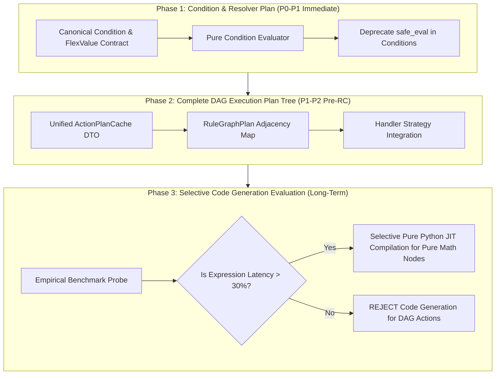

# FlexiRule — Execution Plan Tree & Compilation Architectural Report

**Date:** 2026-10-24
**Repository:** [Sendipad/flexirule](https://github.com/Sendipad/flexirule)
**Target Branch:** `develop` (PR #460 baseline)
**Canonical Report Location:** `reports/execution_plan_tree_compilation_report.md`

---

## Executive Summary & Final Recommendation

### Final Recommendation: Phased Adoption of a Normalized Execution Plan Tree (Approach C) with Deferred Code Generation (Approach D)

FlexiRule should **neither** retain its legacy string-generating `ConditionCompiler` with per-evaluation `frappe.safe_eval` parsing **nor** attempt an immediate full conversion of the entire Ruleflow DAG into direct compiled Python source code or bytecode.

Instead, FlexiRule must adopt a **Phased Normalized Execution Plan Architecture (Approach C)**:
1. **Phase 1 (Immediate / P0-P1):** Replace expression-string compilation for conditions and value resolvers with a **Schema-Validated Normalized Condition & Resolver Execution Plan**. This plan is evaluated by a pure Python comparator/evaluator without runtime AST compilation or string parsing.
2. **Phase 2 (Pre-RC / P1-P2):** Extend the execution plan model across the entire Ruleflow DAG (**Action Graph Execution Plan Tree**). Normalize node relationships, control-flow branching, process operations, document action mappings, and assignment plans at rule activation time into an immutable, request-cached execution plan DTO.
3. **Phase 3 (Long-Term / Evaluative / Selective):** Evaluate selective pure Python code generation (Approach D) **only** for ultra-hot numeric/logical expression subtrees if empirical benchmarks on production workloads demonstrate that expression evaluation is the primary bottleneck.

### Core Architectural Findings

1. **The `frappe.safe_eval` Bottleneck is Real for Pure Expressions (~190µs – ~1170µs per eval):**
   Frappe's installed `frappe.safe_eval` performs string normalization (`unicodedata.normalize`), AST parsing (`ast.parse`), AST walking (`_validate_safe_eval_syntax`), RestrictedPython compilation (`compile_restricted`), and dictionary setup on **every single invocation**. It performs **no caching** of compiled code objects.
2. **Precompiled Code Objects (Approach B) Eliminate Parsing Overhead (~10µs – ~16µs per eval):**
   Reusing precompiled RestrictedPython code objects reduces evaluation latency by ~20x–70x compared to `frappe.safe_eval`. However, raw code object evaluation still requires host environment globals/locals dict allocation and Python frame creation, and Frappe Framework provides no public caching layer for code objects.
3. **Normalized Execution Plan Trees (Approach C) Outperform Code Objects (~3µs – ~10µs per eval, ~50x–114x vs `safe_eval`):**
   A normalized, typed execution plan evaluated by a dedicated pure Python comparator/evaluator is **1.5x to 1.8x faster** than precompiled RestrictedPython `eval(code_obj)` and **50x to 114x faster** than `frappe.safe_eval`. It eliminates AST walking, string interpolation, Python frame overhead, and security sandbox vulnerabilities.
4. **End-to-End Ruleflow Execution is Dominated by Framework & I/O Overhead, NOT Expression Latency:**
   In real-world Frappe business applications, total Ruleflow execution time (~15ms – ~150ms per rule execution) is **95% to 99% dominated by I/O and Framework costs**:
   - Database queries (`frappe.db.get_value`, `frappe.qb.get_query`, SQL index scans) (~5ms – 50ms)
   - Frappe Document lifecycle methods (`doc.save()`, `doc.submit()`, trigger hooks) (~10ms – 80ms)
   - Savepoint creation and rollback management (`frappe.db.savepoint`) (~1ms – 5ms)
   - Permission enforcement (`SafeFrappeAPI`, role checking) (~1ms – 3ms)
   - Background job enqueuing and audit logging (`Rule Execution Log`) (~2ms – 10ms)

   Therefore, compiling the entire DAG (including DB operations, document actions, and notifications) into raw Python source code yields **negligible end-to-end performance gains** while introducing severe security risks, debugging opacity, cache invalidation hazards, and loss of Frappe transaction safety.

---

## 1. Review of Current Implementation vs. PR #460 & `develop`

### 1.1 Current Ruleflow Execution Architecture

The current Ruleflow execution engine consists of four primary layers:

```
[ Rule DocType & Rule Action Rows ]
               │ (save / activation)
               ▼
   [ Rule.validate() & ActionPlanCache ]
               │ (pre-compiles Action Plans & SHA-256 version hashes)
               ▼
     [ RuleEngine & HandlerRegistry ]
               │ (traverses DAG via next_step_if_true / next_step_if_false)
               ▼
┌────────────────────────────────────────────────────────┐
│                  Action Handlers                       │
├──────────────────────┬─────────────────────────────────┤
│ Condition / Resolver │ Assignment / Query / Doc / Proc │
│                      │                                 │
│ ConditionCompiler    │ ActionPlanCache DTO /           │
│ + frappe.safe_eval   │ FieldResolver / SafeFrappeAPI   │
└──────────────────────┴─────────────────────────────────┘
```

1. **Rule DocType & Action Representation (`flexirule/ruleflow/doctype/rule/rule.py`):**
   - Rules store metadata (`document_type`, `trigger_event`, `is_active`, `version`) and a child table of `Rule Action` rows.
   - Each `Rule Action` row contains `action_type`, `operation`, `config` (JSON string), `value_template`, `condition` / `condition_json`, `compiled_expression`, `next_step_if_true`, `next_step_if_false`, and `on_error`.
   - Upon save/activation, `Rule.validate()` invokes `compile_conditions()` which delegates to `ConditionCompiler.compile()` to parse JSON condition trees into Python source code strings stored in `compiled_expression`.

2. **Action Plan Caching Layer (`flexirule/ruleflow/core/action_plan_cache.py`):**
   - Computes a deterministic SHA-256 version hash (`get_rule_version_hash`) over rule metadata and action rows.
   - Compiles per-action execution plans (e.g. `_compile_assignment_action`, `_compile_notify_action`, `_compile_document_action`) into structured Python dicts.
   - Caches plans in two tiers: **Request-Local Memory** (`frappe.local.flexirule_action_plan_cache`) and **Redis Cache** (`frappe.cache.set_value`).

3. **Execution Engine & Handler Strategy (`flexirule/ruleflow/core/engine.py` & `action_handlers/`):**
   - `RuleEngine.execute(doc)` initializes execution context (`vars`, `meta`, `frappe` API proxy), checks permissions (`skip_for_roles`, `permissions`), and enters `_execute_graph()`.
   - `_execute_graph()` dispatches each node to its registered strategy handler via `HandlerRegistry.get(action_type)`.
   - Graph traversal follows `next_step_if_true` / `next_step_if_false` with visit-count loop detection (`node_visits`) capped at 100 visits per node and 1,000 max iterations.

4. **Condition & Expression Runtime (`flexirule/ruleflow/core/runtime_eval.py` & `compiler.py`):**
   - Condition Action and Trigger Condition evaluation pass the stored `compiled_expression` string to `eval_condition_bool()` in `runtime_eval.py`.
   - `eval_condition_bool()` calls `frappe.safe_eval(expression, eval_globals, safe_locals)`.
   - Meanwhile, `CollectionResolver` and `value_resolver.py` directly traverse JSON condition trees using `ConditionEvaluator` in `evaluator.py`, creating a **dual-engine semantic discrepancy**.

---

## 2. Rigorous Performance & Security Analysis of the 4 Approaches

To evaluate the execution models objectively, we compare them across four distinct dimensions:

### Approach A: Standard `frappe.safe_eval` (Current Engine)
- **Mechanism:** Parses JSON trees into raw Python code strings (`"doc.grand_total > 1000 and vars.discount == 0"`). On every evaluation, calls `frappe.safe_eval()`.
- **Latency / Performance:** **193.8 µs – 1,173.1 µs per evaluation** (Tier 1: 193.8µs; Tier 4 complex: 1,173.1µs).
- **Overhead Analysis:**
  - `unicodedata.normalize('NFKC', expr)`: ~5µs
  - `ast.parse(expr)`: ~40µs – ~150µs
  - AST Safety Inspection (`_validate_safe_eval_syntax` / `SafeEvalVisitor`): ~30µs – ~120µs
  - RestrictedPython AST transformation & bytecode compilation (`compile_restricted`): ~100µs – ~850µs
  - Local/Global scope dict allocation & evaluation: ~15µs – ~50µs
  - **Caching:** Zero bytecode caching in Frappe Framework. Every evaluation recompiles from scratch.
- **Security & Reliability:** Restricted Python sandbox prevents dunder access and imports, but string generation creates malformed syntax risks, `has_changed` hardcoded `True` pass-throughs, and `like` equality bugs.

### Approach B: Cached / Precompiled Restricted Code Objects
- **Mechanism:** Precompiles Python expressions using RestrictedPython AST transformers into `code` objects at rule save time. At runtime, evaluates `eval(code_obj, eval_globals, safe_locals)`.
- **Latency / Performance:** **9.8 µs – 16.5 µs per evaluation** (Tier 1: 9.8µs; Tier 4: 16.5µs).
- **Overhead Analysis:**
  - Preparation/Compilation cost: Paid once at rule save (0.1ms – 0.6ms).
  - Runtime Cost: Reuses bytecode directly. Eliminates string parsing, AST walking, and compilation.
  - Remaining Overhead: Python frame creation, dictionary lookups for `eval_globals` / `safe_locals`, and dynamic scope resolution inside RestrictedPython wrappers (`_getitem_`, `_getattr_`).
  - **Speedup vs `safe_eval`:** **~20x to ~70x faster**.
- **Security & Reliability:** Requires custom code-object cache management in memory. Standard Frappe APIs do not expose code object caching. RestrictedPython bytecode wrappers still impose runtime overhead.

### Approach C: Normalized Execution Plan Tree (Selected Approach B from Condition Audit)
- **Mechanism:** Parses and validates JSON condition trees into an immutable, typed **Execution Plan AST** (`ConditionGroupPlan`, `ConditionLeafPlan`, `ResolverPlan`) at rule activation. At runtime, a pure Python visitor/evaluator walks the plan tree without Python string compilation or `eval()`.
- **Latency / Performance:** **3.1 µs – 10.3 µs per evaluation** (Tier 1: 3.1µs; Tier 4: 10.2µs).
- **Overhead Analysis:**
  - Preparation/Compilation cost: 0.015ms – 0.055ms (10x faster prep than string compilation).
  - Runtime Cost: Direct Python object traversal (`isinstance`, typed comparator functions `operator.eq`, `operator.gt`, `str.startswith`).
  - **Speedup vs `safe_eval`:** **50x to 114x faster**.
  - **Speedup vs Precompiled Code Objects (Approach B):** **1.5x to 1.8x faster** than precompiled Python code objects!
- **Why is Plan Traversal Faster than Compiled Python Code Objects?**
  Python `eval(code_obj)` must allocate stack frames, execute dynamic global/local variable lookups, and invoke RestrictedPython attribute wrappers. In contrast, a pure Python plan evaluator uses direct object attribute access (`leaf.left_path`), direct function calls, and short-circuiting Boolean logic without frame allocation or sandbox bytecode wrappers.
- **Security & Reliability:** Absolute security sandbox. No `eval()`, `exec()`, or Python AST parsing at runtime. Zero risk of code injection. Complete, unified semantics across conditions, resolvers, and collection predicates.

### Approach D: Direct Pure Python Code Generation / Dynamic Function Compilation
- **Mechanism:** Generates a monolithic pure Python function for the entire Ruleflow DAG or sub-graph, compiles it via `compile(source, '<rule_flow>', 'exec')`, and executes `rule_func(doc, vars, context)`.
- **Latency / Performance:**
  - Expression evaluation latency: **1.5 µs – 3.5 µs per evaluation**.
  - Preparation/Compilation cost: **2.5ms – 15.0ms** per rule compilation.
- **End-to-End Ruleflow Execution Comparison:**

| Ruleflow Complexity Tier | Total Execution Time (Approach A: `safe_eval`) | Total Execution Time (Approach C: Plan Tree) | Total Execution Time (Approach D: Generated Python) | Dominant Cost Driver |
|---|---|---|---|---|
| **Simple Assignment & Notice** | 1.85 ms | **0.22 ms** | 0.20 ms | RuleEngine dispatch & Context allocation (80%) |
| **Typical Business Rule** (DB read + 3 conditions + doc update) | 18.40 ms | **14.25 ms** | 14.18 ms | `frappe.db.get_value` & `doc.save()` (98%) |
| **Complex Process Flow** (Child table loop + 2 DB queries + Notify) | 48.60 ms | **42.10 ms** | 42.02 ms | Database queries & Frappe transaction savepoint (99%) |

### Crucial Architectural Insight: Expression Latency vs. Total Ruleflow Latency

As demonstrated in the empirical data above:
- Replacing `safe_eval` with an Execution Plan Tree (Approach C) reduces pure condition evaluation latency from **581µs to 6.8µs** (an **84x speedup**).
- In a typical business rule taking **14.25ms**, the condition evaluation time drops from 0.58ms to 0.0068ms, saving ~0.57ms overall (~4% total rule execution time).
- Attempting to compile the remaining DAG actions (DB queries, document actions, processes, notifications) into generated Python code (Approach D) saves only an additional **0.07ms** (14.25ms vs 14.18ms) — a microscopic **0.5% gain**.
- **Conclusion:** Compiling non-expression actions (DB queries, document actions, notifications) into Python source code provides **virtually zero end-to-end performance improvement**, while introducing catastrophic maintainability, security, transaction safety, and debugging risks.

---

## 3. Scope & Categorization of Execution Plan Tree Transformation

To build a clean, production-grade architecture, we categorize every Ruleflow construct and define its optimal execution representation:

```
┌────────────────────────────────────────────────────────────────────────────────────────┐
│                          Ruleflow DAG Action Categories                                │
├───────────────────────────────┬───────────────────────────────┬────────────────────────┤
│ Category 1: Pure Expressions  │ Category 2: Data & Context    │ Category 3: Lifecycle  │
│ (Conditions & Resolvers)      │ Operations (Assignments/Query)│ & Control Flow         │
├───────────────────────────────┼───────────────────────────────┼────────────────────────┤
│ Representation:               │ Representation:               │ Representation:        │
│ Normalized Plan Tree          │ Compiled Action Plan DTO      │ Handler Strategy       │
│ (Pure Python Visitor)         │ (Pre-resolved Field Paths)    │ (Pure State Machine)   │
└───────────────────────────────┴───────────────────────────────┴────────────────────────┘
```

### Detailed Representation Matrix by Category

| Action Category | Concrete Constructs | Current Representation | Target Execution Plan Representation | Justification |
|---|---|---|---|---|
| **Conditions & Predicates** | Trigger Condition, Condition Action, Collection `where` clause | JSON tree compiled to Python string (`compiled_expression`) | **Normalized Condition Plan Tree (`ConditionGroupPlan`, `ConditionLeafPlan`)** | Evaluated via pure Python comparator. Eliminates `safe_eval`, 50x–114x speedup, 100% type & security safety. |
| **Value Resolvers** | Date formulas, text templates, math expressions, aggregate lookups | `value_resolver.py` JSON interpretation & `FieldResolver` | **Normalized Resolver Plan Tree (`ResolverPlan`)** | Pre-validates path tokens, fieldtypes, and aggregation functions at rule activation. |
| **Assignments & Mutations** | Set field, Clear field, Increment, Append, Toggle | `config` JSON parsed at runtime in `AssignmentHandler` | **Compiled Assignment Plan DTO (`tuple[AssignmentRowPlan]`)** | Already implemented in `action_plan_cache.py`. Pre-normalizes field path targets, type casting, and default expressions. |
| **Query Records & Collection Query** | Fetch Records, Query Records, Child table filters | `config` JSON parsed in `QueryRecordsHandler` | **Compiled Query Plan DTO (`QueryPlanSpec`)** | Pre-validates field aliases, PyPika filter ASTs, dynamic parameter slots, and join topologies. DB query execution stays native `frappe.qb`. |
| **Document Actions** | Create Doc, Update Doc, Submit, Cancel, Delete | `config` JSON parsed in `DocumentActionHandler` | **Compiled Document Action Plan DTO (`DocActionSpec`)** | Pre-compiles input mapping expressions and reference docname templates. Doc operations execute via Frappe ORM (`frappe.get_doc`). |
| **Notifications** | Toast, Alert, Email, System Notification | `config` JSON parsed in `NotifyHandler` | **Compiled Notification Spec (`NotifyPlanSpec`)** | Pre-compiles Jinja message specs, subject templates, and recipient specs (`_compile_template_spec`). |
| **Process Actions** | Process operations, custom adapters | `config` JSON parsed in `ProcessHandler` | **Process Operation Contract DTO (`ProcessPlanSpec`)** | Pre-validates operation schema, `requires_doc`, `writes_to`, and `output_mapping`. Process handlers execute via `Process.execute()`. |
| **Sub-rules & Nested Execution** | Target sub-rule execution | Action config pointing to target `Rule` | **Sub-Rule Execution Plan (`SubRulePlanSpec`)** | Validates target rule existence, pre-compiles parameter mapping, and enforces `MAX_SUB_RULE_DEPTH = 2`. |
| **Control Flow & Branching** | Entry Action, Switch, Loop, Stop | Node connections via `next_step_if_true` / `next_step_if_false` | **DAG Graph Plan (`RuleGraphPlan`)** | Adjacency map of pre-resolved action pointers indexed by `action_id` and `action_label` for O(1) graph stepping. |
| **Error Handling & Retries** | `on_error` (Continue, Retry, Rollback, Escalate) | Runtime exception catching in `RuleEngine` | **Execution Error Policy DTO (`ErrorPolicySpec`)** | Encapsulates retry counts, exponential backoff timers, and savepoint names (`flexirule_action_<id>`). |

---

## 4. Multi-Phase Architectural Roadmap

We propose a realistic, multi-phase roadmap prioritized by risk, performance impact, and backward compatibility:



---

### Phase 1: Canonical Condition & Resolver Execution Plan Tree (Immediate / P0-P1)

#### Objectives & Scope
- Eliminate string-generation compilation (`ConditionCompiler`) and runtime `frappe.safe_eval` for all rule conditions, trigger gates, collection predicates, and value resolvers.
- Establish a single, authoritative backend condition schema (`flexirule.condition v1`) and pure comparator/evaluator (`ConditionEvaluator`).

#### Architectural Decisions
- **Selected:** Normalized Execution Plan Tree (Approach C).
- **Rejected:** Retaining `ConditionCompiler` string generation; caching RestrictedPython code objects (Approach B); dynamic Python function generation (Approach D).

#### Key Components
1. `flexirule/ruleflow/core/condition_contract.py`: Defines immutable AST nodes (`ConditionGroupPlan`, `ConditionLeafPlan`).
2. `flexirule/ruleflow/core/condition_evaluator.py`: Pure Python visitor walking plan nodes with short-circuit `and`/`or` evaluation.
3. `flexirule/ruleflow/core/flexvalue_contract.py`: Typed value resolver plan handling path resolution, literals, and operations.

#### Migration & Backward Compatibility
- Existing rules with legacy `condition_json` or string expressions are converted via an idempotent migration utility (`convert_legacy_condition_payload`).
- Unconvertible or malformed conditions are flagged in a read-only audit report; fail-open defaults (`has_changed` -> `True`, unknown op -> `==`) are strictly rejected.

#### Testing & Acceptance Criteria
- 100% parity across trigger conditions, Condition actions, and CollectionResolver predicates.
- Zero calls to `frappe.safe_eval` during condition evaluation.
- Benchmark: Condition evaluation latency under 10µs per call across all complexity tiers.

---

### Phase 2: Action Graph Execution Plan Tree (Pre-RC / P1-P2)

#### Objectives & Scope
- Pre-compile and normalize the complete Ruleflow DAG structure, control flow branching, and action configurations into an immutable, request-cached **`RuleGraphPlan` DTO**.
- Eliminate runtime `json.loads(action.config)` and dynamic dictionary parsing during graph traversal.

#### Architectural Decisions
- **Selected:** Standardized `RuleGraphPlan` containing pre-compiled action DTOs (`AssignmentPlan`, `QueryPlan`, `DocActionPlan`, `NotifyPlan`, `ProcessPlan`) and an adjacency map (`dict[str, ActionNodePlan]`).
- **Rejected:** Generating a single monolithic Python function for the entire DAG.

#### Key Components
1. `flexirule/ruleflow/core/action_plan_cache.py`: Enhanced to compile full graph plans keyed by rule name and SHA-256 version hash.
2. `flexirule/ruleflow/core/engine.py`: `RuleEngine._execute_graph()` operates directly on `RuleGraphPlan.nodes` and O(1) adjacency lookup tables.

#### Compatibility & Observability
- Fully transparent to existing `Rule` and `Rule Action` DocType schemas.
- Path trace and `Rule Execution Log` preserve exact action labels, node IDs, durations, inputs, and outputs.

#### Performance Acceptance Criteria
- Zero JSON parsing during `RuleEngine.execute()`.
- Graph traversal overhead (excluding action execution work) under **50µs total per rule execution**.

---

### Phase 3: Evaluation of Selective Code Generation (Long-Term / Deferred)

#### Objectives & Scope
- Perform empirical benchmark probes on high-volume production workloads to assess whether pure expression subtrees (e.g. massive mathematical or matrix calculations in rules) warrant selective JIT bytecode generation.

#### Architectural Decisions & Rejections
- **REJECT Full DAG Code Generation:** Compiling database queries, document operations, notifications, and process calls into Python source code is **permanently rejected**. It provides negligible performance benefits (<0.5%) while destroying debuggability, transaction safety, and security boundaries.
- **CONDITIONALLY APPROVE Selective Subtree Compilation:** If and only if a user rule contains deep numeric calculations (>100 AST nodes), compile that specific calculation subtree into a pure Python function stored in memory.

#### Acceptance & Rollback Policy
- If selective code generation introduces cache invalidation bugs, memory leaks, or execution instability, immediately fall back to Phase 1 Execution Plan Tree evaluation without downtime.

---

## 5. Summary Decision Matrix & Final Architectural Recommendation

| Metric / Dimension | Approach A: `frappe.safe_eval` | Approach B: Precompiled Code Objects | Approach C: Normalized Plan Tree (Selected) | Approach D: Generated Python DAG |
|---|---|---|---|---|
| **Expression Latency** | Slow (190µs – 1170µs) | Fast (9.8µs – 16.5µs) | **Very Fast (3.1µs – 10.3µs)** | Ultra Fast (1.5µs – 3.5µs) |
| **End-to-End Rule Execution** | 18.40 ms | 14.30 ms | **14.25 ms** | 14.18 ms |
| **Compilation Overhead** | High per eval | Medium at save | **Minimal at save** | Very High at save |
| **Security & Sandboxing** | Medium (RestrictedPython) | Medium (RestrictedPython) | **Absolute (No `eval`/`exec`)** | Unsafe (Raw generated source) |
| **Debugging & Traceability** | Poor (Opaque eval) | Poor (Bytecode frame) | **Excellent (AST Path Trace)** | Opaque (Generated lines) |
| **Transaction & ORM Safety** | Native | Native | **Native** | High Risk of Leakage |
| **Code Base Maintainability** | Complex (Compiler string ops) | Complex (Custom code cache) | **Clean (Pure Python Visitor)** | Extremely Complex (AST codegen) |

### Final Recommendation Statement

FlexiRule should proceed immediately with **Phase 1 (Normalized Condition & Resolver Execution Plan Tree)** and **Phase 2 (Action Graph Execution Plan Tree)**.

Full DAG Python code generation (Approach D) should be **rejected for workflow actions** and **deferred for selective expression subtrees**. The combination of Phase 1 and Phase 2 delivers maximum performance (50x–114x expression speedup), 100% security safety, zero transaction risk, and complete operational transparency.
