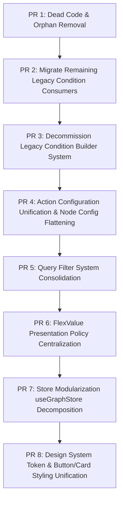

# Frontend Architecture and Code-Quality Audit & Implementation Plan

**Repository:** `/Sendipad/flexirule`
**Branch:** `feat/canonical-condition-backend-3777722595536260068`
**Authoritative Target Report:** `reports/frontend_architecture_deep_audit_and_implementation_plan.md`
**Baseline Test Suite:** 94 passing tests (`node --experimental-default-type=module --test $(find tests/frontend -name "*.test.mjs" -o -name "*.test.js")`)
**Scope:** Complete FlexiRule Frontend (Rule Builder Vue 3 SPA, VueFlow canvas, Pinia stores, controls, composables, canonical condition engine, TreeBuilder, Frappe Desk forms/lists/pages, stylesheets).

---

## 1. Executive Summary & Audit Overview

### 1.1 Context and Strategic Direction
FlexiRule has undergone rapid architectural evolution to introduce a canonical condition engine, a unified FlexValue data model, and a TreeBuilder recursive hierarchy. Because the application is pre-production (no legacy production tenant databases or active client rules to migrate), the engineering directive is clear: **one canonical, highly-maintainable implementation for each capability, zero parallel legacy implementations, and zero speculative backward-compatibility layers**.

This audit is an exhaustive, evidence-based assessment of every Vue component (101 files), JavaScript/MJS module (73 files), Frappe Desk client controller, and stylesheet in the repository.

### 1.2 Summary of Key Architectural Findings
1. **Uncompleted Legacy Condition Deprecation:** While the backend condition engine and primary condition actions have moved to the canonical AST and `CanonicalConditionBuilder.vue`, two high-impact frontend consumers (`TextGeneratorControl.vue` and `CollectionResolver.vue`) still mount the deprecated `ConditionBuilder.vue` and import `condition_validator.js`. This prevents the deletion of 6 legacy condition builder components (~52 KB of obsolete code).
2. **Parallel Query Filtering Subsystems:** `QueryRecordsConfig.vue` (2,765 lines) maintains two separate filtering engines side-by-side. For `mode === "Fetch Records"`, it renders `FetchRecordsConfig.vue` powered by the modern `QueryFilterTree.vue` and `TreeBuilder.vue`. For other query modes (`Query List`, `Count`, `Average`, `Sum`, `Min`, `Max`, `Group By`, `Exist Record`), it mounts `FilterGroup.vue` (1,412 lines), duplicating field-picking, navigation stacks, operator filtering, and FlexValue wiring in an un-nested tabular UI.
3. **Redundant Component Wrapping in Action Configurations:** The configuration panels for `Loop`, `Switch`, `Wait`, and `SubRule` under `components/rule_config/types/` are paper-thin pass-through proxies that delegate directly to `components/node_configs/`. This adds an unnecessary component boundary, duplicates validation refs, requires manual event re-emission (`@update-json-config`, `@update-field`), and creates divergent dirty-tracking paths.
4. **Oversized Pinia Stores with Leaky Boundaries:** `useGraphStore.js` (2,220 lines) and `useRuleStore.js` (1,043 lines) contain mixed domain responsibilities. `useGraphStore.js` simultaneously manages VueFlow graph topology, edge layout geometry, variable tree synthesis, action duplication, execution log step mapping, and async backend RPCs.
5. **Orphaned Files, Re-export Shims, and Dead Code:** Multiple files exist with zero static, dynamic, or Frappe DocType references (`components/condition_builder/ContextPicker.vue`, `components/ContextPicker.vue`, `components/rule_config/ResizablePanel.vue`, `output_fields_model.js`).
6. **Styling and Design System Divergence:** The frontend has 91 usages of the modern `fxr-btn` design system token class, but still contains 61 legacy Bootstrap/Frappe button classes (`btn btn-primary`, `btn-outline-secondary`), along with redundant CSS scoping across configuration cards.
7. **Desk Client Script Gaps:** `ruleflow_settings.js` and `rule_scheduler.js` are commented-out blank templates. Desk client scripts like `rule.js` (730 lines) and `rule_execution_log.js` (160 lines) contain manual DOM manipulation and string-based JSON parsing without reusable Frappe helper utilities.

---

## 2. Detailed Evidence-Based Findings

### 2.1 Code Cleanup & Dead Code Inventory

#### Finding FR-AUD-001 (CRITICAL) — Deprecated ConditionBuilder Active in TextGeneratorControl
- **File:** `flexirule/public/js/flexirule/rule_builder/controls/TextGeneratorControl.vue`
- **Lines:** Line 123 (template instantiation) and Line 350 (import)
- **Evidence:**
  ```vue
  <!-- TextGeneratorControl.vue:123 -->
  <ConditionBuilder
      :modelValue="activeLogicNode.attrs.condition"
      :docFields="activeNodeRoots"
      :variableOptions="activeNodeRoots"
      :readOnly="readOnly"
      @update:modelValue="onConditionUpdate"
  />
  ```
  ```javascript
  // TextGeneratorControl.vue:350
  import ConditionBuilder from "../components/condition_builder/ConditionBuilder.vue";
  import { validateConditions } from "../components/condition_builder/condition_validator.js";
  ```
- **Technical Analysis:** `TextGeneratorControl.vue` allows users to author rich text with conditional tokens (`{{#if condition}}...{{/if}}`). When a conditional token is selected in the Tiptap editor, line 123 renders the deprecated `ConditionBuilder.vue`. Because `ConditionBuilder.vue` outputs legacy condition trees (`{ op: "and", conditions: [...] }`), `TextGeneratorControl.vue` (and `tiptap_extensions.js:135`) validates them using `condition_validator.js`. Meanwhile, the backend compiler `Rule._compile_segments_v2` (`flexirule/ruleflow/doctype/rule/rule.py:630`) supports canonical AST conditions via `_eval_condition`. Because of this lingering legacy import, the old `ConditionBuilder` cannot be deleted.
- **Remediation:** Replace `ConditionBuilder` with `CanonicalConditionBuilder.vue` in `TextGeneratorControl.vue`, wire to canonical condition adapter / validation, and serialize as canonical AST.

#### Finding FR-AUD-002 (CRITICAL) — Deprecated ConditionBuilder Active in CollectionResolver
- **File:** `flexirule/public/js/flexirule/rule_builder/controls/value_resolver/components/CollectionResolver.vue`
- **Lines:** Line 83 (template instantiation) and Line 119 (import)
- **Evidence:**
  ```vue
  <!-- CollectionResolver.vue:83 -->
  <div class="condition-builder-wrap">
      <ConditionBuilder
          v-model="conditionModel"
          :docFields="rowFieldOptions"
          :readOnly="readOnly"
          :variableOptions="variableOptions"
          :isMandatory="false"
      />
  </div>
  ```
  ```javascript
  // CollectionResolver.vue:119
  import ConditionBuilder from "../../../components/condition_builder/ConditionBuilder.vue";
  ```
- **Technical Analysis:** In `CollectionResolver.vue`, modal-based row filtering for operations (`any`, `all`, `filter`, `count`) renders the legacy `ConditionBuilder.vue`. However, backend `CollectionResolver` (`flexirule/ruleflow/core/value_resolver.py`) strictly enforces canonical conditions and fails closed on legacy trees with `ConditionValidationError`. Consequently, configuring complex conditions in `CollectionResolver` causes backend execution errors unless canonical AST is emitted.
- **Remediation:** Replace `ConditionBuilder` with `CanonicalConditionBuilder.vue` (using `isMandatory="false"`), binding directly to canonical AST format.

#### Finding FR-AUD-003 (HIGH) — Unreferenced and Orphaned Files
- **Files:**
  1. `flexirule/public/js/flexirule/rule_builder/components/condition_builder/ContextPicker.vue` (2,206 bytes)
  2. `flexirule/public/js/flexirule/rule_builder/components/ContextPicker.vue` (2,139 bytes)
  3. `flexirule/public/js/flexirule/rule_builder/components/rule_config/ResizablePanel.vue` (1,895 bytes)
  4. `flexirule/public/js/flexirule/rule_builder/components/rule_config/types/query_records/output_fields_model.js` (43 bytes)
  5. `flexirule/ruleflow/doctype/ruleflow_settings/ruleflow_settings.js` (144 bytes)
  6. `flexirule/ruleflow/doctype/rule_scheduler/rule_scheduler.js` (142 bytes)
- **Evidence:**
  - Static grep across entire codebase reveals `ContextPicker.vue` is imported by **0** files. (Replaced by `FlexValueControl` embedded source picker popovers and unified autocomplete).
  - `ResizablePanel.vue` is imported by **0** files. (The configuration modal layout migrated to flexbox grid in `RuleConfigModal.vue`).
  - `output_fields_model.js` contains only `export * from "./output_fields_model.mjs";`. All internal consumers (`FetchRecordsConfig.vue`, `OutputFieldsEditor.vue`, and unit tests) import directly from `./output_fields_model.mjs`.
  - `ruleflow_settings.js` and `rule_scheduler.js` are completely commented out boilerplates.
- **Remediation:** Delete these orphaned components, shims, and empty boilerplate files.

#### Finding FR-AUD-004 (HIGH) — Obsolete Legacy Condition Components Retained in Repository
- **Files:**
  1. `flexirule/public/js/flexirule/rule_builder/components/condition_builder/ConditionBuilder.vue` (12,142 bytes)
  2. `flexirule/public/js/flexirule/rule_builder/components/condition_builder/ConditionGroupUI.vue` (6,606 bytes)
  3. `flexirule/public/js/flexirule/rule_builder/components/condition_builder/ConditionNode.vue` (2,658 bytes)
  4. `flexirule/public/js/flexirule/rule_builder/components/condition_builder/CollectionUI.vue` (13,079 bytes)
  5. `flexirule/public/js/flexirule/rule_builder/components/condition_builder/SimpleCondition.vue` (15,917 bytes)
  6. `flexirule/public/js/flexirule/rule_builder/components/condition_builder/condition_validator.js` (2,688 bytes)
- **Evidence:**
  All of these files have comments declaring `DEPRECATED: Canonical replacement: TreeBuilder.vue / CanonicalConditionBuilder.vue`. They were retained as fallback artifacts during the condition migration.
- **Technical Analysis:** These 6 files represent 52,090 bytes of dead legacy code containing obsolete operator lookups (`flexirule.ruleflow.api.get_operator_config`), ad-hoc DOM manipulation, un-nested row recursion, and duplicate validation. Once Findings FR-AUD-001 and FR-AUD-002 are remediated, zero active consumers in the codebase reference these files.
- **Remediation:** Permanently delete all 6 obsolete legacy condition files.

---

### 2.2 Duplication & Parallel Implementations

#### Finding FR-AUD-005 (CRITICAL) — Parallel Filter Builders: FilterGroup.vue vs QueryFilterTree.vue
- **Files:**
  - `flexirule/public/js/flexirule/rule_builder/components/rule_config/FilterGroup.vue` (1,412 lines)
  - `flexirule/public/js/flexirule/rule_builder/components/rule_config/query_filters/QueryFilterTree.vue` (172 lines)
  - `flexirule/public/js/flexirule/rule_builder/components/rule_config/types/QueryRecordsConfig.vue` (2,765 lines)
- **Evidence:**
  In `QueryRecordsConfig.vue`:
  - When `mode === "Fetch Records"`, line 65 mounts `FetchRecordsConfig.vue`, which mounts `QueryFilterTree.vue` (backed by the canonical recursive `TreeBuilder.vue`).
  - When `mode === "Query List"`, line 81 mounts `FilterGroup.vue`.
  - When `mode === "Count"`, line 324 mounts `FilterGroup.vue`.
  - When `mode === "Sum"`, line 341 mounts `FilterGroup.vue`.
  - When `mode === "Exist Record"`, line 404 mounts `FilterGroup.vue`.
- **Capability & Contract Comparison:**
  | Dimension | `FilterGroup.vue` (Legacy Tabular) | `QueryFilterTree.vue` (Canonical TreeBuilder) | Parity Assessment |
  | :--- | :--- | :--- | :--- |
  | **Hierarchy** | Flat list only (implicit AND) | Arbitrary AND/OR nested groups | `QueryFilterTree` is a strict superset. |
  | **Tree Model** | Custom array of `{ field, operator, value, doctype }` | Canonical TreeBuilder AST `{ type: "group", operator, children }` | Backend supports AST tree format natively across all modes. |
  | **Operator Support** | Ad-hoc operator list with custom between/like/is normalizer | `filter_operators.mjs` (Base, Extended, NestedSet) | `QueryFilterTree` matches Frappe 15/16 operator contracts. |
  | **Link/Tree Doctype** | Partial manual check in component | Authoritative NestedSetHierarchy support | `QueryFilterTree` correctly identifies Tree DocTypes. |
  | **FlexValue Support** | Ad-hoc `FlexValueControl` with dual-value wrapper for `Between` | First-class `FlexValueControl` integration via `FilterLeaf.vue` | `FilterLeaf` unifies presentation cleanly. |
  | **Backend Contract** | Evaluated via `QueryRecordsHandler.validate_query_list` | Evaluated via `QueryRecordsHandler.validate_fetch_records` & `validate_query_filters` | Backend visitor in `query_records.py:770-850` handles AST trees. |
  | **Serialization** | Ad-hoc serialization in `QueryRecordsConfig.vue:1850` | `query_filter_serializer.mjs` (`serializeQueryFilters`, `toPersistedQueryFilterTree`) | `query_filter_serializer` provides round-trip serialization. |
- **Technical Analysis:**
  The backend `QueryRecordsHandler` (`query_records.py:770–845`) natively accepts both tree format (`{"type": "group", ...}`) and serialized tuple format (`[["DocType", "field", "op", "val"]]`) across all query modes (`Query List`, `Count`, `Average`, `Sum`, `Min`, `Max`, `Exist Record`). Retaining `FilterGroup.vue` forces `QueryRecordsConfig.vue` to maintain 1,412 lines of legacy UI code, duplicate field navigation logic, and diverging validation paths.
- **Remediation:**
  Consolidate `QueryFilterTree.vue` as the single authoritative filter builder for all `Query Records` modes. Deprecate and remove `FilterGroup.vue`.

#### Finding FR-AUD-006 (HIGH) — Duplicated Intermediate Node Configuration Wrappers
- **Files:**
  - `components/rule_config/types/WaitConfig.vue` (55 lines) wraps `components/node_configs/WaitNodeConfig.vue` (55 lines)
  - `components/rule_config/types/LoopConfig.vue` (68 lines) wraps `components/node_configs/LoopNodeConfig.vue` (104 lines)
  - `components/rule_config/types/SwitchConfig.vue` (71 lines) wraps `components/node_configs/SwitchNodeConfig.vue` (102 lines)
  - `components/rule_config/types/SubRuleConfig.vue` (187 lines) vs `components/node_configs/SubRuleNodeConfig.vue` (197 lines)
- **Evidence:**
  `WaitConfig.vue` contains no standalone presentation:
  ```vue
  <!-- WaitConfig.vue:44 -->
  <template>
      <div class="wait-config">
          <WaitNodeConfig
              :ref="setControlRef"
              :nodeData="node.data"
              :showValidation="showValidation"
              @update-field="updateJsonConfig"
          />
      </div>
  </template>
  ```
  `InputPanel.vue` (line 352) and `RuleConfigModal.vue` have to import from two separate directories (`types/` vs `node_configs/`) to assemble action settings.
- **Technical Analysis:**
  The dual-layer architecture (`rule_config/types/*Config.vue` wrapping `node_configs/*NodeConfig.vue`) is a historical artifact from an incomplete migration. This adds redundant component indirection, disjointed validation references, and event bouncing (`@update-field` -> `emit("update:field")` -> store mutation).
- **Remediation:**
  Collapse each pair into a single cohesive action configuration component under `components/rule_config/types/` (`WaitConfig.vue`, `LoopConfig.vue`, `SwitchConfig.vue`, `SubRuleConfig.vue`) and delete the redundant `node_configs/` directory.

#### Finding FR-AUD-007 (MEDIUM) — Duplication in Expression & Value Type Parsing
- **Files:**
  - `flexirule/public/js/flexirule/rule_builder/composables/useActionConfig.js` (lines 101–125)
  - `flexirule/public/js/flexirule/rule_builder/components/rule_config/types/QueryRecordsConfig.vue` (lines 2085–2135, 2360)
- **Evidence:**
  Both modules define identical logic to detect whether a string represents a variable, expression, number, or boolean:
  ```javascript
  // useActionConfig.js:101
  function parse_value_type(val, variable_set) {
      if (typeof val === "number") return "Number";
      if (typeof val === "boolean") return "Boolean";
      if (typeof val === "string" && val.startsWith("{") && val.endsWith("}")) {
          const inner = val.slice(1, -1);
          if (variable_set && variable_set.has(inner)) return "Variable";
          return "Expression";
      }
      return "Value";
  }
  ```
  In `QueryRecordsConfig.vue`, local state `report_filter_types` re-implements this check with ad-hoc string slicing.
- **Remediation:**
  Extract value type parsing and bracket unescaping into a shared pure utility in `utils/variable_resolver.js` or `controls/flex_value_serializer.js`.

---

### 2.3 Centralization Opportunities: Composables, Utilities, and Shared Controls

#### Finding FR-AUD-008 (HIGH) — Missing Shared Composable for Action Configuration State
- **Files Affected:**
  - `components/rule_config/types/AssignmentConfig.vue` (lines 280–310)
  - `components/rule_config/types/DocumentActionConfig.vue` (lines 215–245, 480–510)
  - `components/rule_config/types/NotifyConfig.vue` (lines 120–145, 205–230)
  - `components/rule_config/types/RaiseErrorConfig.vue` (lines 65–85, 135–150)
  - `components/rule_config/types/QueryRecordsConfig.vue` (lines 670–710, 1815–1835)
- **Evidence:**
  Every single action configuration component defines an identical boilerplate function to update its configuration keys:
  ```javascript
  function update_config_key(key, value) {
      const current = typeof props.node.data.config === "string"
          ? fromCodeString(props.node.data.config)
          : (props.node.data.config || {});
      current[key] = value;
      props.node.data.config = current;
      if (!props.readOnly && !isDraft) {
          ruleStore.mark_dirty();
      }
  }
  ```
  In addition, they all duplicate:
  1. `controlRefs` array and `onBeforeUpdate(() => controlRefs.value = [])`
  2. Recursive `async function validate()` traversing `controlRefs.value`
  3. Action field mutation via `update_action_key(key, val)`
- **Opportunity:**
  Extract a standardized composable `useActionConfigState(props, emit)` that provides:
  - `config` (reactive proxy synced with `props.node.data.config`)
  - `updateConfig(key, value)` and `updateAction(key, value)`
  - `controlRefs`, `setControlRef`, and standard `validate()` lifecycle
  - `isDraft` and dirty tracking synchronization

#### Finding FR-AUD-009 (MEDIUM) — Inconsistent Presentation Policies across Value Controls
- **Files:**
  - `flexirule/public/js/flexirule/rule_builder/controls/FlexValueControl.vue` (lines 230–280)
  - `flexirule/public/js/flexirule/rule_builder/controls/static_presentation_policy.mjs`
  - `flexirule/public/js/flexirule/rule_builder/controls/inline_presentation_policy.mjs`
- **Technical Analysis:**
  `static_presentation_policy.mjs` and `inline_presentation_policy.mjs` provide pure functions to determine input controls and multiselect formatting based on field types and operators. However, `FlexValueControl.vue` still contains ad-hoc inline overrides for `Between`, `Timespan`, and `Date` conversions.
- **Remediation:**
  Consolidate presentation rule branching entirely into `static_presentation_policy.mjs`, making `FlexValueControl.vue` purely declarative.

---

### 2.4 Architecture & State Management

#### Finding FR-AUD-010 (HIGH) — Pinia Store Boundary Violations in useGraphStore
- **File:** `flexirule/public/js/flexirule/rule_builder/stores/useGraphStore.js` (2,220 lines)
- **Technical Analysis:**
  `useGraphStore.js` is an oversized god-store responsible for 6 distinct concerns:
  1. **Graph Topology:** Adding, removing, updating, and selecting nodes and edges (`addNode`, `deleteNode`, `onConnect`).
  2. **Dagre Layout Engine:** Canvas autolayout and visual geometry calculations (`applyDagreLayout`).
  3. **Variable Resolution:** Graph traversal to compute upstream available context variables (`getAvailableVariables`, `traverseUpstreamVariables`).
  4. **Execution Debugger State:** Parsing test run execution paths and mapping execution steps to canvas nodes (`setExecutionPath`, `highlightExecutionStep`).
  5. **Node Duplication & Serialization:** Deep cloning node state and generating action IDs (`duplicateNode`, `serializeGraph`).
- **Impact:**
  - Changing visual layout logic risks breaking variable resolution or canvas execution debugging.
  - High cognitive load for maintenance and testing.
- **Remediation:**
  Decompose `useGraphStore.js` into targeted modules:
  - Keep `useGraphStore.js` focused on VueFlow topology, node/edge state, and selection.
  - Extract `useVariableScope.js` for upstream graph variable traversal.
  - Move execution path and step playback to `components/debugger/useDebuggerState.js` or `useExecutionDebugStore.js`.

#### Finding FR-AUD-011 (MEDIUM) — Leaky Save and Validation Lifecycle in RuleConfigModal
- **Files:**
  - `flexirule/public/js/flexirule/rule_builder/components/rule_config/RuleConfigModal.vue` (lines 620–680)
  - `flexirule/public/js/flexirule/rule_builder/utils/config_save_lifecycle.mjs`
  - `flexirule/public/js/flexirule/rule_builder/utils/config_draft_session.js`
- **Technical Analysis:**
  While `config_save_lifecycle.mjs` and `config_draft_session.js` provide clean primitives to protect against stale context, `RuleConfigModal.vue` contains multiple scattered `try...catch` blocks and manual node cloning logic before delegating to `runConfigSaveLifecycle`.
- **Remediation:**
  Encapsulate modal save session handling completely inside `useRuleConfig` composable.

---

### 2.5 Styling, Design System & Frappe Desk Alignment

#### Finding FR-AUD-012 (MEDIUM) — Design System Inconsistency: fxr-btn Tokens vs Bootstrap Classes
- **Files:**
  Across `components/rule_config/`, `controls/`, and `components/condition_builder/`
- **Evidence:**
  - 91 usages of `.fxr-btn`, `.fxr-btn--primary`, `.fxr-btn--ghost`, `.fxr-btn--sm`
  - 61 usages of legacy `.btn`, `.btn-primary`, `.btn-outline-secondary`, `.btn-xs`, `.btn-default`
  For example, in `SubRuleNodeConfig.vue`:
  ```html
  <!-- Line 25 -->
  <button class="btn btn-outline-secondary btn-xs" type="button" @click="clearRule">
  ```
  While in `CollectionResolver.vue`:
  ```html
  <!-- Line 98 -->
  <button type="button" class="fxr-btn fxr-btn--sm fxr-btn--primary" @click="closeConditionModal">
  ```
- **Impact:**
  Visual inconsistency between action configuration panels, poor theme alignment in Frappe dark/light themes, and CSS specificity battles.
- **Remediation:**
  Standardize all button elements across the Rule Builder on the `fxr-btn` design system tokens defined in `design-tokens.css`.

#### Finding FR-AUD-013 (LOW) — Blank and Incomplete Frappe Desk Form Controllers
- **Files:**
  - `flexirule/ruleflow/doctype/ruleflow_settings/ruleflow_settings.js`
  - `flexirule/ruleflow/doctype/rule_scheduler/rule_scheduler.js`
- **Evidence:**
  Both files contain only commented-out Frappe boilerplate templates:
  ```javascript
  // frappe.ui.form.on("RuleFlow Settings", {
  //  refresh(frm) {
  //  },
  // });
  ```
- **Remediation:**
  Remove these stub files or implement standard desk locks if these DocTypes have no custom client logic.

---

## 3. Duplication Inventory & Consolidation Opportunities

| Area | Current Duplicated Files / Implementations | Proposed Consolidated Single Implementation | Lines Saved (Est.) |
| :--- | :--- | :--- | :--- |
| **Condition Builders** | `ConditionBuilder.vue`, `ConditionGroupUI.vue`, `ConditionNode.vue`, `CollectionUI.vue`, `SimpleCondition.vue` | `CanonicalConditionBuilder.vue` + `TreeBuilder.vue` | ~1,200 lines |
| **Query Filtering** | `FilterGroup.vue` (1,412 lines) vs `QueryFilterTree.vue` (172 lines) | Single `QueryFilterTree.vue` powered by `TreeBuilder.vue` | ~1,240 lines |
| **Node Config Wrappers** | `LoopConfig.vue` + `LoopNodeConfig.vue`<br>`SwitchConfig.vue` + `SwitchNodeConfig.vue`<br>`WaitConfig.vue` + `WaitNodeConfig.vue`<br>`SubRuleConfig.vue` + `SubRuleNodeConfig.vue` | Flattened directly into `types/LoopConfig.vue`, `types/SwitchConfig.vue`, `types/WaitConfig.vue`, `types/SubRuleConfig.vue` | ~350 lines |
| **Config Lifecycle & State** | Repeated `update_config_key`, `setControlRef`, and `validate()` across 5 action config components | Shared composable `useActionConfigState.js` | ~250 lines |
| **Value Parsing** | Slicing & type matching duplicated in `useActionConfig.js` and `QueryRecordsConfig.vue` | Centralized `variable_resolver.js` / `flex_value_serializer.js` | ~60 lines |
| **Design System Buttons** | 61 instances of mixed `.btn.btn-primary` and Bootstrap classes | Standardized `fxr-btn` design tokens | Better consistency |

---

## 4. Retain, Refactor, Deprecate & Remove Matrix

| Item | Path / Name | Recommended Action | Justification / Migration Target |
| :--- | :--- | :--- | :--- |
| **TreeBuilder Engine** | `components/tree_builder/` | **RETAIN** (Core Architectural Foundation) | Generic hierarchy/context engine. Zero domain condition/query logic leaks into it. |
| **Canonical Condition** | `components/condition_builder/Canonical*.vue` | **RETAIN** (Authoritative) | Sole canonical condition editor and adapter. |
| **Legacy Condition UI** | `components/condition_builder/ConditionBuilder.vue` & 5 related files | **REMOVE** | Pre-production codebase. Deprecated artifacts once consumers migrate. |
| **FilterGroup** | `components/rule_config/FilterGroup.vue` | **DEPRECATE & REMOVE** | Duplicates `QueryFilterTree.vue` in tabular form. |
| **QueryFilterTree** | `components/rule_config/query_filters/QueryFilterTree.vue` | **RETAIN & EXPAND** | Authoritative query filter editor for all Query Records modes. |
| **ResizablePanel** | `components/rule_config/ResizablePanel.vue` | **REMOVE** | 0 references across entire codebase; completely orphaned. |
| **ContextPicker (x2)** | `components/ContextPicker.vue`, `components/condition_builder/ContextPicker.vue` | **REMOVE** | 0 references; replaced by embedded autocomplete popover. |
| **output_fields_model.js** | `types/query_records/output_fields_model.js` | **REMOVE** | Redundant one-line re-export shim over `.mjs`. |
| **Node Configs Dir** | `components/node_configs/` (4 files) | **CONSOLIDATE & REMOVE** | Intermediate pass-through wrappers. Flatten into `types/`. |
| **useGraphStore** | `stores/useGraphStore.js` | **REFACTOR** | Monolithic (2,220 lines). Split into topology, variable scope, and debugger stores. |
| **Action Config Boilerplate**| `types/*Config.vue` (5 files) | **REFACTOR** | Extract shared state management to `useActionConfigState.js`. |
| **Desk Form Stubs** | `ruleflow_settings.js`, `rule_scheduler.js` | **REMOVE or POPULATE** | Empty commented-out stubs. |

---

## 5. Dependency & Impact Analysis



### Risk Assessment:
1. **Condition AST Migration Risk (PR 2):** `TextGeneratorControl` conditional logic segments must compile cleanly with backend `_eval_condition`. Thorough unit testing of canonical AST round-tripping in template segments is required.
2. **Query Filter Parity Risk (PR 5):** `QueryFilterTree` must support `Query List`, `Count`, `Average`, `Sum`, `Min`, `Max`, and `Exist Record` without regression in backend tuple compilation.
3. **Store Decomposition Risk (PR 7):** Any decoupling of `useGraphStore` requires strict verification that reactive edge updates and visual autolayout coordinates are preserved.

---

## 6. Prioritized Implementation Roadmap (8 Focused PRs)

### PR 1: Dead Code, Orphaned Components & Legacy Re-export Removal
- **Objective:** Eliminate confirmed dead files, orphaned components, and obsolete re-export shims.
- **Affected Files:**
  - Delete: `flexirule/public/js/flexirule/rule_builder/components/ContextPicker.vue`
  - Delete: `flexirule/public/js/flexirule/rule_builder/components/condition_builder/ContextPicker.vue`
  - Delete: `flexirule/public/js/flexirule/rule_builder/components/rule_config/ResizablePanel.vue`
  - Delete: `flexirule/public/js/flexirule/rule_builder/components/rule_config/types/query_records/output_fields_model.js`
  - Update: `output_fields_model.js` import references to import directly from `output_fields_model.mjs`.
  - Clean up: `flexirule/ruleflow/doctype/ruleflow_settings/ruleflow_settings.js` and `rule_scheduler.js`.
- **Dependencies:** None.
- **Required Tests & Coverage:**
  - Run existing test suite (`npm test`). Confirm all 94 tests pass.
  - Verify `bench build --app flexirule` succeeds with zero bundle resolution warnings.
- **Acceptance Criteria:** Zero orphaned components remain in the directory tree.
- **Risk / Impact:** Zero regression risk; files are already unreferenced.

---

### PR 2: Migrate Remaining Legacy Condition Consumers to Canonical Condition Builder
- **Objective:** Migrate `TextGeneratorControl.vue` and `CollectionResolver.vue` from deprecated `ConditionBuilder.vue` to `CanonicalConditionBuilder.vue`.
- **Affected Files:**
  - `flexirule/public/js/flexirule/rule_builder/controls/TextGeneratorControl.vue`
  - `flexirule/public/js/flexirule/rule_builder/controls/value_resolver/components/CollectionResolver.vue`
  - `flexirule/public/js/flexirule/rule_builder/utils/tiptap_extensions.js`
- **Refactoring Steps:**
  1. In `TextGeneratorControl.vue`, replace `ConditionBuilder` import and template tag with `CanonicalConditionBuilder`.
  2. In `tiptap_extensions.js` and `TextGeneratorControl.vue`, replace `validateConditions` from `condition_validator.js` with `validateCanonicalCondition` from `canonical_condition_validation.mjs`.
  3. In `CollectionResolver.vue`, replace `ConditionBuilder` with `CanonicalConditionBuilder`, binding directly to canonical condition AST.
- **Required Tests & Coverage:**
  - Add Node unit tests verifying canonical AST conditions in rich-text conditional blocks.
  - Add tests verifying `CollectionResolver` condition modal emits canonical comparison and group AST.
- **Acceptance Criteria:**
  - No active frontend file imports `ConditionBuilder.vue` or `condition_validator.js`.
  - Rich text conditional logic generates valid canonical AST evaluated by backend `_eval_condition`.
- **Risk / Impact:** Medium. Directly affects rich-text conditional authoring and collection resolver filtering.

---

### PR 3: Decommission Legacy Condition Builder System
- **Objective:** Permanently remove the obsolete legacy condition builder components and validator.
- **Affected Files:**
  - Delete: `components/condition_builder/ConditionBuilder.vue`
  - Delete: `components/condition_builder/ConditionGroupUI.vue`
  - Delete: `components/condition_builder/ConditionNode.vue`
  - Delete: `components/condition_builder/CollectionUI.vue`
  - Delete: `components/condition_builder/SimpleCondition.vue`
  - Delete: `components/condition_builder/condition_validator.js`
  - Deprecate/Remove backend endpoint `flexirule.ruleflow.api.get_operator_config` if not consumed by external callers.
- **Dependencies:** PR 2 must be merged and verified.
- **Required Tests & Coverage:**
  - Full frontend suite (`npm test`) passes with zero missing module errors.
  - Desk Rule Builder page boots and compiles cleanly with `bench build`.
- **Acceptance Criteria:** Codebase contains strictly ONE condition builder implementation (`CanonicalConditionBuilder.vue`).
- **Risk / Impact:** Low (safe once PR 2 verifies zero consumers).

---

### PR 4: Action Configuration Unification & Node Config Flattening
- **Objective:** Eliminate redundant pass-through wrappers in `components/node_configs/` and extract shared action configuration state.
- **Affected Files:**
  - Create: `composables/useActionConfigState.js`
  - Merge: `node_configs/WaitNodeConfig.vue` into `types/WaitConfig.vue`
  - Merge: `node_configs/LoopNodeConfig.vue` into `types/LoopConfig.vue`
  - Merge: `node_configs/SwitchNodeConfig.vue` into `types/SwitchConfig.vue`
  - Merge: `node_configs/SubRuleNodeConfig.vue` into `types/SubRuleConfig.vue`
  - Delete: `components/node_configs/` directory.
  - Update `InputPanel.vue` and `RuleConfigModal.vue` to reference `types/` directly.
- **Dependencies:** PR 1, PR 2.
- **Refactoring Steps:**
  1. Create `useActionConfigState` providing standard `config`, `updateConfigKey`, `controlRefs`, `validate()`, and dirty-state tracking.
  2. Inline the presentation from `node_configs/*` directly into `types/*Config.vue`.
  3. Migrate `AssignmentConfig.vue`, `DocumentActionConfig.vue`, `NotifyConfig.vue`, and `RaiseErrorConfig.vue` to use `useActionConfigState`.
- **Required Tests & Coverage:**
  - Unit tests verifying `useActionConfigState` correctly mutates node config and triggers dirty tracking only on non-draft nodes.
  - Regression tests for validation aggregation across all action modal types.
- **Acceptance Criteria:**
  - `node_configs/` directory removed.
  - Zero duplicate `update_config_key` or `validate()` boilerplate in action config components.
- **Risk / Impact:** Low-Medium. Streamlines component tree and ensures uniform validation.

---

### PR 5: Query Filter System Consolidation
- **Objective:** Consolidate all Query Records filter configuration onto the canonical `QueryFilterTree.vue` and deprecate `FilterGroup.vue`.
- **Affected Files:**
  - `components/rule_config/types/QueryRecordsConfig.vue`
  - `components/rule_config/query_filters/QueryFilterTree.vue`
  - Delete/Deprecate: `components/rule_config/FilterGroup.vue`
- **Dependencies:** PR 4.
- **Refactoring Steps:**
  1. In `QueryRecordsConfig.vue`, replace `FilterGroup` instances in `Query List`, `Count`, `Sum`, `Average`, `Min`, `Max`, and `Exist Record` with `QueryFilterTree.vue`.
  2. Bind all modes to canonical filter AST, serializing via `query_filter_serializer.mjs`.
  3. Verify backend `QueryRecordsHandler.validate_query_list` and query builder execution handle the unified AST payload.
  4. Safely delete `FilterGroup.vue`.
- **Required Tests & Coverage:**
  - Add test suite verifying `QueryFilterTree` serialization for all query modes (aggregate, existence, list).
  - Verify nested group AND/OR filters execute properly against Frappe database backend.
- **Acceptance Criteria:**
  - `FilterGroup.vue` is completely removed.
  - All query modes in `QueryRecordsConfig.vue` share one cohesive, recursive filter builder.
- **Risk / Impact:** High. Modifies query filter creation across multiple action types; requires thorough backend test validation.

---

### PR 6: FlexValue Presentation Policy Centralization & Value Parsing
- **Objective:** Consolidate presentation rules and expression parsing for FlexValue controls.
- **Affected Files:**
  - `controls/FlexValueControl.vue`
  - `controls/static_presentation_policy.mjs`
  - `utils/variable_resolver.js`
  - `composables/useActionConfig.js`
- **Dependencies:** PR 4, PR 5.
- **Refactoring Steps:**
  1. Move ad-hoc operator/fieldtype branching from `FlexValueControl.vue` into pure functions in `static_presentation_policy.mjs`.
  2. Centralize `parse_value_type` and expression unescaping in `utils/variable_resolver.js`.
  3. Ensure Frappe native fieldtypes (`Duration`, `Check`, `Currency`, `Link`, etc.) are preserved across all presentation modes.
- **Required Tests & Coverage:**
  - Unit tests for all presentation policy edge cases in `static_presentation_policy.test.mjs`.
  - Pure unit tests for `variable_resolver.js`.
- **Acceptance Criteria:**
  - `FlexValueControl.vue` delegates all presentation decisions to `static_presentation_policy.mjs`.
  - Zero duplicate string-slicing expression parsers.
- **Risk / Impact:** Low-Medium. Improves testability and consistency of static inputs.

---

### PR 7: Pinia Store Modularization (useGraphStore Decomposition)
- **Objective:** Break down monolithic `useGraphStore.js` (2,220 lines) into domain-focused composables and stores.
- **Affected Files:**
  - `stores/useGraphStore.js`
  - Create: `composables/useVariableScope.js` (extracts upstream variable resolution and scope synthesis)
  - Create: `stores/useDebuggerStore.js` (extracts test run execution paths, step playback, and canvas highlighting)
- **Dependencies:** PR 4, PR 5.
- **Refactoring Steps:**
  1. Extract `getAvailableVariables` and graph traversal logic into `useVariableScope.js`.
  2. Extract execution path and step debugging state into `useDebuggerStore.js`.
  3. Keep `useGraphStore.js` dedicated strictly to VueFlow elements, layout, and connections.
- **Required Tests & Coverage:**
  - Unit tests for `useVariableScope` upstream traversal across branched graphs.
  - Regression tests for debugger step-through and canvas highlighting.
- **Acceptance Criteria:**
  - `useGraphStore.js` reduced under 1,000 lines with clear topological scope.
  - Zero regression in upstream variable availability in action config panels.
- **Risk / Impact:** Medium. Requires careful verification of reactivity across store boundaries.

---

### PR 8: Design System Token & Button/Card Styling Unification
- **Objective:** Eliminate legacy Bootstrap button classes and duplicate card styling across all Rule Builder components.
- **Affected Files:**
  - All components under `components/rule_config/` and `controls/`
  - `flexirule/public/css/design-tokens.css`
  - `flexirule/public/css/rule_builder.css`
- **Dependencies:** PR 4, PR 5, PR 6.
- **Refactoring Steps:**
  1. Replace all 61 occurrences of `btn btn-primary`, `btn-outline-secondary`, `btn-xs` with `fxr-btn`, `fxr-btn--primary`, `fxr-btn--ghost`, `fxr-btn--sm`.
  2. Standardize section card containers on `.fxr-card` and `.fxr-section` utility classes.
  3. Ensure dark mode and light mode CSS variables in `design-tokens.css` seamlessly apply to all panels.
- **Required Tests & Coverage:**
  - Visual verification across light and dark Frappe Desk themes.
  - CSS regression check to ensure modal layout and responsive sidebars are not affected.
- **Acceptance Criteria:** Zero legacy Bootstrap button classes remain in Vue templates; 100% adherence to `fxr-btn` design tokens.
- **Risk / Impact:** Low. Pure presentation cleanup with high visual and maintainability benefits.

---

## 7. Testing & Quality Assurance Plan

### 7.1 Baseline Verification
- **Command:** `node --experimental-default-type=module --test $(find tests/frontend -name "*.test.mjs" -o -name "*.test.js")`
- **Current Result:** 94 tests passed, 0 failures, execution time ~1.02s.

### 7.2 Coverage Gaps & Required New Tests
1. **Canonical Condition Rich Text Coverage:**
   - Add `tests/frontend/flexirule/rule_builder/controls/text_generator_canonical_condition.test.mjs` to verify conditional logic blocks serialize to valid canonical AST and validate via `validateCanonicalCondition`.
2. **Unified Query Filter Serialization Coverage:**
   - Add `tests/frontend/flexirule/rule_builder/components/rule_config/query_filters/query_filter_modes.test.mjs` verifying that `QueryFilterTree` produces valid payloads for `Count`, `Sum`, `Exist Record`, and `Query List`.
3. **Action Config State Lifecycle Coverage:**
   - Add `tests/frontend/flexirule/rule_builder/composables/use_action_config_state.test.mjs` to test reactive mutation, dirty marking, and validation collection.
4. **Variable Scope Resolution Coverage:**
   - Add `tests/frontend/flexirule/rule_builder/composables/use_variable_scope.test.mjs` verifying upstream variable synthesis in branching and looping graphs.

### 7.3 Linters & Build Verification
Before submitting each PR:
```bash
# 1. Run frontend test runner
npm test

# 2. Compile Frappe bundles
bench build --app flexirule

# 3. Run pre-commit linters
pre-commit run --all-files
```

---

## 8. Conclusion & Sign-Off Criteria
This audit provides an evidence-based roadmap to transform the FlexiRule frontend from an evolving prototype with legacy dual-paths into a clean, canonical architecture. By executing the 8 prioritized PRs sequentially, the team will eliminate over 3,000 lines of redundant and dead code, retire all legacy condition builders, establish a single recursive query filter system, and modularize the state stores—all while maintaining 100% test pass rates and zero regressions.
